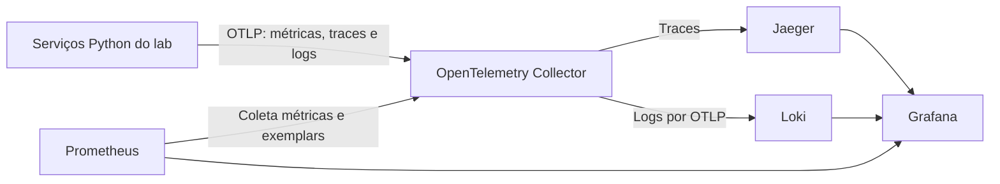
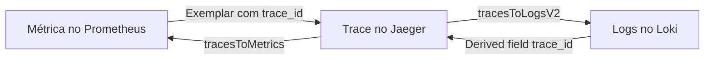

<!-- TOC -->

- [Plano: laboratórios práticos](#plano-laboratórios-práticos)
  - [Situação da implementação](#situação-da-implementação)
  - [Objetivo e escopo](#objetivo-e-escopo)
  - [Situação atual](#situação-atual)
  - [Decisões aprovadas](#decisões-aprovadas)
  - [Catálogo de laboratórios](#catálogo-de-laboratórios)
  - [Arquitetura](#arquitetura)
  - [Stack de observabilidade](#stack-de-observabilidade)
  - [Dashboards por laboratório](#dashboards-por-laboratório)
  - [Makefile](#makefile)
  - [Padrões de Python, uv e mise](#padrões-de-python-uv-e-mise)
  - [Variáveis de ambiente e segredos](#variáveis-de-ambiente-e-segredos)
  - [Atualização da documentação](#atualização-da-documentação)
  - [Fases de implementação](#fases-de-implementação)
  - [Critérios de aceite](#critérios-de-aceite)
  - [Riscos](#riscos)
  - [Referências](#referências)

<!-- TOC -->

# Plano: laboratórios práticos

Este plano descreve como acrescentar laboratórios em Python e Docker Compose ao repositório, orquestrados por Makefile e observáveis com Prometheus, Grafana, Jaeger e Loki. As versões e os recursos citados foram consultados nas fontes oficiais em 2026-11-02. A implementação está concluída; o resultado e os desvios estão em [Situação da implementação](#situação-da-implementação).

## Situação da implementação

Os 15 labs passaram em `make lab-smoke` em Ubuntu 22.04, com `LLM_PROVIDER=fake`. Não foram testados macOS, provedores reais de LLM nem `make install-dependencies` em máquina limpa; este último só em `DRY_RUN=1`.

Desvios em relação ao plano:

| Item planejado | O que foi feito | Motivo |
| --- | --- | --- |
| Dockerfile em cada lab | `labs/python.Dockerfile` compartilhado; só o server do lab 08 tem o próprio | Evita 14 cópias do mesmo arquivo |
| GitHub MCP opcional no lab 07 | Não incluído | Não havia token para testar. O server `tickets` cumpre o papel no cenário |
| Painel de traces no dashboard | Grafo de dependências | A busca do Grafana 13.3 não funciona com o Jaeger 2.22 |
| `GF_FEATURE_TOGGLES_ENABLE` | Arquivo `grafana.ini` | A variável está *deprecated* |
| Notebooks nos labs 12 e 15 | Também no lab 09 | Criados pela API, por `scripts/grafana_seed.py` |
| Variáveis em thresholds e subtítulos | Thresholds com `valueExpr` nos gráficos de latência; subtítulo não configurado | Não localizei a opção de subtítulo no JSON do painel |
| Especialistas do lab 14 em containers separados | Um processo com vários agentes A2A | Reduz o consumo de memória |

## Objetivo e escopo

**Objetivo:** cada conteúdo que pode ser demonstrado com código passa a ter um laboratório executável, ligado ao documento correspondente.

**Dentro do escopo:**

- 15 laboratórios, cobrindo os 12 documentos técnicos.
- Orquestração por Makefile: `start`, `stop`, `clean` e `logs`, além da verificação e instalação de dependências por sistema operacional.
- Observabilidade com correlação entre métricas, traces e logs nos laboratórios em que isso faz sentido.
- Atualização de `README.md`, `CLAUDE.md`, `CONTRIBUTING.md`, `REQUIREMENTS*.md` e `docs/`.

**Fora do escopo:**

- Preparar os laboratórios para produção. Cada um é didático e deve declarar suas limitações.
- Adicionar CI, a menos que seja pedido.
- Criar um laboratório para o `docs/guia-para-leigos.md`, que apenas passa a apontar para os laboratórios.

## Situação atual

O repositório recebeu arquivos de outro projeto, chamado "Central de Salas" (`desafio-a2a-com-mcp`). Eles são um bom ponto de partida, mas não funcionam aqui.

| Arquivo | Problema encontrado | Ação |
| --- | --- | --- |
| `Makefile` | Depende de `scripts/`, `servidor-mcp/`, `agente/`, `validador/`, `dados/`, `exemplos/` e `VERSION`, que não existem | Reescrever, aproveitando a estrutura de `help`, `check-os` e `check-docker` |
| `docker-compose.yml` | Descreve o desafio anterior, depende de `observability/` (ausente) e tem versões defasadas | Substituir pelos arquivos Compose de cada laboratório |
| `pyproject.toml` e `uv.lock` | Citam testes e diretórios do projeto anterior | Refazer como workspace uv |
| `.env.example` | Variáveis do desafio anterior, valores vazios e comentários em inglês | Refazer conforme [a seção de variáveis](#variáveis-de-ambiente-e-segredos) |
| `mise.toml` | Python 3.14.8 e uv 0.13.1; as versões mais recentes são 3.14.10 e 0.13.6 | Atualizar |
| `REQUIREMENTS*.md` | Citam `desafio-a2a-com-mcp`, o validador e `make up` | Adaptar; aproveitar os passos de Docker, Colima e mise |
| `.gitignore` | Ignora `.env`, mas não `.venv/` nem caches do `ruff` e do `mypy` | Acrescentar essas entradas |
| `CLAUDE.md`, `CONTRIBUTING.md` e `README.md` | Afirmam que o repositório não tem código nem dependências | Atualizar |

## Decisões aprovadas

| # | Decisão | Recomendação | Alternativa |
| --- | --- | --- | --- |
| 1 | **Lab de `docs/mcpserver.md`, que trata do SDK em TypeScript** | Server em TypeScript dentro de um container e client em Python. É a única exceção à regra de usar Python, e o Node.js não precisa estar no host para esse lab | Só Python, perdendo a demonstração entre linguagens |
| 2 | **Chaves de LLM** | Provedor determinístico `LLM_PROVIDER=fake` como padrão, para os labs rodarem sem custo nem chave; provedores reais são opcionais | Exigir chave em todos os labs que usam LLM |
| 3 | **Envio de logs ao Loki** | OpenTelemetry Collector como entrada única, enviando logs por OTLP. Dispensa montar o socket do Docker | Grafana Alloy lendo os logs dos containers, como no `docker-compose.yml` atual |
| 4 | **Stack de observabilidade** | Definição única incluída por `include` no Compose de cada lab, com um lab observável por vez | Stack compartilhada em projeto próprio, que permite labs simultâneos, mas mistura os dados |
| 5 | **Versão do Python** | Manter o ramo 3.14 (3.14.10), já usado pelo projeto, e avaliar o 3.15 depois | Adotar o 3.15.2 agora, após confirmar a compatibilidade das dependências |
| 6 | **Nomes em tools e métricas** | Código em en-US, inclusive tools, por exemplo, `issue_retention_bonus` | Manter em português só os nomes que já aparecem nos documentos |

## Catálogo de laboratórios

A coluna "Stack" indica se o lab inclui Prometheus, Grafana, Jaeger, Loki e o Collector. Os labs 01 e 02 ficam sem stack porque mostram formatos de mensagem, sem execução contínua para observar.

| Lab | Documento | O que demonstra | Serviços além da stack | Stack |
| --- | --- | --- | --- | --- |
| `lab-01-nxm` | `o-caos-das-integracoes.md` | Uma tool descrita nos formatos de três provedores e a conta de adaptadores N×M contra N+M | Nenhum | Não |
| `lab-02-json-rpc` | `wire-format-json-rpc.md` | Request, response e notification brutos, respostas fora de ordem, `_meta`, `resultType` e códigos de erro, em stdio e HTTP | Server de eco | Não |
| `lab-03-camadas` | `tool-calling-vs-mcp-a2a.md` | A mesma capacidade por tool calling, MCP e A2A, comparando saltos nos traces | Server MCP, agente A2A | Sim |
| `lab-04-host-client-server` | `host-client-server.md` | Um client por server, filtro de contexto, timeout e circuit breaker com um server instável | Dois servers MCP, um deles com falhas injetadas | Sim |
| `lab-05-primitivos` | `primitivos-mcp.md` | Resources, tools e prompts no cenário de pedidos, com JSON Schema e Inspector | Server MCP | Sim |
| `lab-06-prompts-inferencia` | `prompt-sampling.md` | Prompts parametrizados, chamada direta ao provedor, sampling como legado por `InputRequiredResult` e limite de recursão | Server MCP, provedor `fake` | Sim |
| `lab-07-ecossistema` | `operacao-ecossistema-mcp.md` | Fanout entre servers, `server/discover`, eras do Inspector e smoke test com `--cli` | PostgreSQL 18.6, server próprio somente leitura; GitHub MCP opcional | Sim |
| `lab-08-sdk-typescript` | `mcpserver.md` | Schema Zod, `isError`, `AbortSignal`, paginação por cursor e client Python contra server TypeScript | Server TypeScript, PostgreSQL | Sim |
| `lab-09-finance-admin` | `fastmcp.md` | `MCPServer`, trava de 20%, `ToolError` e `MCPError`, progresso, logs e testes de regra de negócio | PostgreSQL | Sim |
| `lab-10-injecao` | `seguranca-camada.md` (semântica) | Injeção indireta e dados adulterados, com e sem isolamento, validação de contrato e circuit breaker | Server MCP, provedor `fake` | Sim |
| `lab-11-oauth` | `seguranca-camada.md` (identidade) | OAuth 2.1 com PKCE, audiência, scopes, renovação de token e rejeição de `token passthrough` | Keycloak, server MCP | Sim |
| `lab-12-producao` | `seguranca-camada.md` (produção) | Imagem multi-stage sem root, `read_only`, `cap_drop`, allowlist, `429`, proteção contra DNS rebinding e caos controlado | Docker MCP Gateway `v0.44.3`, nginx, server MCP | Sim |
| `lab-13-a2a-tasks` | `agent-to-agent.md` (protocolo) | Agent Card, estados `TASK_STATE_*`, pausa e retomada, streaming, webhook e artifacts | Agente A2A, receptor de webhook | Sim |
| `lab-14-a2a-padroes` | `agent-to-agent.md` (padrões) | Delegado, hierárquico com falha parcial e pipeline | Vários agentes A2A | Sim |
| `lab-15-integrador` | `fundamentos.md` | Assistente de pós-venda com A2A, MCP, tool calling, identidade e correlação completa | Agentes, servers MCP, PostgreSQL | Sim |

Bibliotecas de referência: `mcp` 2.3.0 (`MCPServer`, revisão 2026-07-28), `a2a-sdk` 1.3.0 (A2A 1.0) e `@modelcontextprotocol/server` 2.4.0 no lab 08.

## Arquitetura

### Estrutura de diretórios

```text
.
├── Makefile
├── mise.toml
├── pyproject.toml              # Raiz do workspace uv
├── uv.lock
├── .env.example
├── scripts/                    # Scripts chamados pelo Makefile
└── labs/
    ├── common/                 # Pacote compartilhado: settings, OpenTelemetry e logs
    ├── observability/
    │   ├── compose.yaml        # Serviços incluídos pelos labs
    │   ├── otel-collector/
    │   ├── prometheus/
    │   ├── loki/
    │   └── grafana/
    │       ├── provisioning/   # Datasources, dashboards e alertas
    │       └── dashboards/     # Um JSON por lab
    └── lab-09-finance-admin/
        ├── README.md
        ├── compose.yaml        # include: ../observability/compose.yaml
        ├── Dockerfile
        ├── pyproject.toml
        ├── src/
        └── tests/
```

### Fluxo de telemetria



### Correlação no Grafana



## Stack de observabilidade

### Versões

| Componente | Imagem | Observação |
| --- | --- | --- |
| Grafana | `grafana/grafana:13.3.0` | O `docker-compose.yml` atual usa 13.2.4 |
| Prometheus | `prom/prometheus:v3.15.1` | Com `--enable-feature=exemplar-storage` |
| Jaeger | `cr.jaegertracing.io/jaegertracing/jaeger:2.22.0` | Registro indicado na documentação oficial |
| Loki | `grafana/loki:3.7.9` | Requer `allow_structured_metadata: true` para OTLP |
| OpenTelemetry Collector | `otel/opentelemetry-collector-contrib:0.164.0` | Roteia os três sinais |

As tags ficam fixas no Compose. Um alvo `make check-versions` compara essas tags com as releases mais recentes, sem atualizar nada sozinho.

### Integração entre os datasources

Tudo é provisionado por YAML, com UIDs fixos (`prometheus`, `jaeger` e `loki`):

- **Jaeger:** `tracesToLogsV2` aponta para o Loki, `tracesToMetrics` para o Prometheus, e `nodeGraph` fica ligado.
- **Loki:** `derivedFields` transforma `trace_id` em link para o Jaeger. O campo chega como structured metadata pelo OTLP, então o tipo do derived field deve ser Label.
- **Prometheus:** `exemplarTraceIdDestinations` aponta para o Jaeger.
- **Dashboard comum:** cada dashboard tem painéis de métricas, traces e logs filtrados pelo `service.name` do lab.

### Recursos do Grafana 13.3

Recursos do what's new que dependem de feature toggle, ativados por `GF_FEATURE_TOGGLES_ENABLE`:

| Recurso | Toggle | Estágio em 13.3.0 | Uso nos labs |
| --- | --- | --- | --- |
| Novo visual | `grafana.visualDesignRefresh` | Public preview | Toda a interface |
| Notebooks | `dashboard.notebooks` | Public preview | Notebook de investigação no lab 12 e no lab 15 |
| Variáveis entre dashboards | `grafana.dashboardGlobalVariables` | Experimental no registro de toggles; preview no what's new | Variável global `lab` |
| Painel de texto com dados | `grafana.newTextPanel` e `text.newFeatures` | Public preview | Resumos de estado nos dashboards |
| Checagem de logs no trace | `grafana.dynamicTraceToLogs` | Public preview | Links de trace para logs |
| Jaeger pela API `/api/v3` | `jaegerEnableGrpcEndpoint` | Experimental | Necessário porque o Jaeger 2.21 removeu endpoints HTTP antigos |

Recursos disponíveis sem toggle, a serem usados nos dashboards:

- Variáveis em thresholds, por exemplo para o limite de latência.
- Descrição como subtítulo do painel.
- Comparação de período em cada painel.
- Cross-filter em histogram, state timeline e status history.
- Ordenação por múltiplos campos e `refId` estável em transformações.

Ficam de fora:

| Recurso | Motivo |
| --- | --- |
| Alert Advisor, cabeçalhos em PDF e banners dispensáveis | Não disponíveis no Grafana OSS |
| Grafana Assistant | Fora do objetivo dos labs |
| Git Sync | Os labs usam provisionamento local por arquivo |
| Plugin Prometheus Alerting e importação do Alertmanager | Experimental ou sem Alertmanager na stack |

Três pontos devem ser testados na fase 1 antes de valerem como requisito:

1. Se `grafana.dashboardGlobalVariables` exige `app_mode=development`. A documentação diz que toggles de desenvolvimento exigem esse modo.
2. Como provisionar notebooks e variáveis globais. Se não houver provisionamento por arquivo, usar a API em um script ou instruções manuais no README.
3. Se o `prometheus` exporter do Collector entrega exemplars ao Prometheus. A alternativa é o receptor OTLP do próprio Prometheus.

## Dashboards por laboratório

Cada dashboard é versionado em JSON e provisionado automaticamente. Os nomes de métricas abaixo são propostas, a serem revistos contra as convenções semânticas do OpenTelemetry durante a implementação.

| Lab | Pergunta do dashboard | Métricas principais | Traces e logs |
| --- | --- | --- | --- |
| 03 | Quanto custa cada camada? | Latência e chamadas por `layer` | Comparação de spans por camada |
| 04 | O circuit breaker protegeu o host? | `lab_circuit_breaker_state`, timeouts e falhas por server | Span da falha e log de abertura do circuito |
| 05 | Como os primitivos são usados? | Chamadas e latência por `primitive` e por nome | Sequência de leitura antes da ação |
| 06 | Quanto custa a inferência? | `lab_llm_tokens_total`, custo estimado e profundidade de recursão | Rodadas de `InputRequiredResult` |
| 07 | Qual a diferença entre os servers? | Latência, erros e quantidade de capacidades por server | Fanout em um único trace |
| 08 | O cancelamento libera recursos? | Cancelamentos, duração e erros por tipo | Span interrompido e log de limpeza |
| 09 | A política financeira está funcionando? | `lab_bonus_rejections_total`, valores concedidos, erros `isError` e latência | Trace e log de cada rejeição |
| 10 | Os ataques foram contidos? | Conteúdo bloqueado, ações impedidas e circuito aberto | Tríade da verdade: pedido, retorno bruto e ação |
| 11 | Quem acessou o quê? | Tokens aceitos e rejeitados por motivo e por scope | Decisão de acesso, sem o token no log |
| 12 | O deploy prova suas propriedades? | Respostas `429`, `421` e `401`, chamadas bloqueadas e saúde | Trace do erro induzido com stack trace |
| 13 | Como as Tasks evoluem? | Tasks por estado, tempo em cada estado e eventos de streaming | Linha do tempo de uma Task |
| 14 | Qual padrão custa mais? | Latência por padrão, falhas parciais e profundidade | Divergência e convergência no Node Graph |
| 15 | O fluxo ponta a ponta está saudável? | Taxa, erros e duração (RED) por serviço e tokens | Trace completo entre agentes e servers |

## Makefile

O Makefile é a única interface. Os alvos seguem um padrão comum, e o lab é escolhido por `LAB`:

| Alvo | Função |
| --- | --- |
| `make help` | Lista os alvos |
| `make check-os` | Recusa sistema ou arquitetura sem suporte |
| `make check-dependencies` | Confere mise, Python, uv, Docker, Compose, buildx, daemon e portas |
| `make install-dependencies` | Instala o que falta, conforme o sistema, seguindo `REQUIREMENTS-UBUNTU.md` ou `REQUIREMENTS-MACOS.md` |
| `make install` | Instala as ferramentas do `mise.toml`, roda `uv sync --locked` e cria o `.env` |
| `make check-env` | Falha se um segredo exigido pelo lab estiver ausente ou como `CHANGEME` |
| `make secret` | Gera os segredos locais que ainda estiverem como `CHANGEME` |
| `make lab-list` | Lista os labs, com documento e serviços |
| `make lab-start LAB=09` | Valida o ambiente, sobe o lab e mostra as URLs |
| `make lab-run LAB=09` | Executa o cenário de demonstração |
| `make lab-logs LAB=09` | Acompanha os logs; `SERVICE=` filtra por serviço |
| `make lab-stop LAB=09` | Para o lab e mantém os volumes |
| `make lab-clean LAB=09` | Remove containers, volumes e imagens do lab |
| `make lab-test LAB=09` | Executa os testes do lab |
| `make test`, `make lint`, `make fmt` | Atuam sobre todo o workspace |

Regras de implementação:

- **Instalação com sudo:** `make install-dependencies` mostra o que fará e pede confirmação, porque altera o sistema. `DRY_RUN=1` só exibe os comandos.
- **Limpeza:** `make lab-clean` afeta apenas o projeto Compose do lab informado.
- **Falhas:** cada erro indica a causa e o próximo comando. Portas ocupadas são detectadas antes de subir o lab.
- **Isolamento:** o projeto Compose se chama `lab-09`, por exemplo, para evitar colisão entre labs.
- **Lógica:** o que for além de poucas linhas fica em `scripts/`, testado com `shellcheck`.

## Padrões de Python, uv e mise

- **mise:** fixa `python`, `uv` e `node` em `mise.toml`. O Node.js serve apenas para o Inspector, que exige a versão 22.19 ou mais nova.
- **uv:** workspace com um único `uv.lock` na raiz, um `pyproject.toml` por lab e `uv sync --locked` no Makefile e nas imagens. Dependências sempre adicionadas com `uv add`.
- **Estrutura:** layout `src/`, com separação entre domínio e camada MCP, como orienta `docs/fastmcp.md`.
- **Qualidade:** `ruff` para lint e formatação, `mypy` em modo estrito e `pytest`. Cada lab testa ao menos o caminho feliz e uma falha prevista.
- **Configuração:** `pydantic-settings`, com validação na inicialização e sem valores secretos padrão.
- **Logs:** módulo `logging` em JSON, enviado por OTLP e para `stderr`. `print` é proibido em servers stdio.
- **Imagens:** multi-stage, usuário sem root, `HEALTHCHECK` e `.dockerignore`.
- **Compose:** portas publicadas em `127.0.0.1`, limites de recursos, `read_only` quando possível e tags sempre fixas.

### Idioma do código

| Item | Idioma |
| --- | --- |
| Identificadores, nomes de tools, métricas, mensagens de log e erros | en-US |
| Comentários e docstrings | pt-BR |
| Comentários em Compose, YAML, Makefile e `.env.example` | pt-BR |
| README de cada lab | pt-BR |

Comentários explicam o porquê e ligam o código ao conceito do documento, sem repetir o que o código já diz.

## Variáveis de ambiente e segredos

- `.env` fica fora do Git. `.env.example` é versionado, com todos os nomes, valores padrão e `CHANGEME` em cada segredo.
- `make check-env` bloqueia `CHANGEME` nos segredos exigidos, pois o Compose detectaria só valores ausentes, não um valor de exemplo.
- Chaves opcionais continuam como `CHANGEME` e são ignoradas enquanto `LLM_PROVIDER=fake`.
- Tokens e senhas nunca aparecem em logs nem em atributos de spans; o `lab-11` testa isso.
- Para evitar vazamentos, o plano recomenda ativar a proteção de push do GitHub no repositório.

Exemplo do formato do `.env.example`:

```dotenv
# --- Grafana ---
GRAFANA_PORT=3000
GRAFANA_ADMIN_USER=admin
# Segredo: senha do administrador local do Grafana. Use `make secret` para gerar um valor aleatório.
GRAFANA_ADMIN_PASSWORD=CHANGEME

# --- Provedor de LLM ---
# Valores aceitos: fake (padrão, sem custo e sem chave), anthropic, openai ou gemini.
LLM_PROVIDER=fake
# Segredo opcional: chave da API da Anthropic, usada só com LLM_PROVIDER=anthropic.
ANTHROPIC_API_KEY=CHANGEME
# Segredo opcional: chave da API da OpenAI, usada só com LLM_PROVIDER=openai.
OPENAI_API_KEY=CHANGEME
# Segredo opcional: chave da API do Gemini, usada só com LLM_PROVIDER=gemini.
GEMINI_API_KEY=CHANGEME

# --- Serviços dos labs ---
# Segredo: senha local do PostgreSQL dos labs 07, 08, 09 e 15.
POSTGRES_PASSWORD=CHANGEME
# Segredo: senha do administrador local do Keycloak no lab 11.
KEYCLOAK_ADMIN_PASSWORD=CHANGEME
# Segredo: token que a borda injeta nas chamadas ao backend no lab 12.
MCP_BEARER_TOKEN=CHANGEME
# Segredo opcional: token do GitHub, com o mínimo de permissões, para o GitHub MCP do lab 07.
GITHUB_TOKEN=CHANGEME

# --- OpenTelemetry ---
OTEL_EXPORTER_OTLP_ENDPOINT=http://otel-collector:4318
LOG_LEVEL=INFO
```

## Atualização da documentação

| Arquivo | Mudança |
| --- | --- |
| `README.md` | Nova seção "Laboratórios": pré-requisitos, configuração do `.env`, tabela com documento, comandos de iniciar, executar e parar cada lab e URLs. Trilha de leitura com uma coluna de lab |
| `labs/*/README.md` | Objetivo, conceito, passo a passo, resultado esperado, o que observar em cada ferramenta, limitações e referências |
| `docs/*.md` | Nova seção `## Laboratório`, antes de `## Referências`, com link, comandos e correspondência de nomes em português e inglês |
| `docs/guia-para-leigos.md` | Indicação "Experimente" nas seções com lab, explicando cada termo novo |
| `CLAUDE.md` | Estrutura, regras de código, idioma, segredos, stack e observabilidade. Revisão de "não há código" |
| `CONTRIBUTING.md` | Tabela de estrutura, como criar um lab, validação (`make lint`, `make test`, `make lab-test`) e checklist de pull request |
| `REQUIREMENTS*.md` | Remoção do projeto anterior e novos alvos do Makefile. Revisão da memória do Colima, hoje em 4 GB, depois de medir a stack |

Os documentos técnicos e os labs devem usar as mesmas versões de referência. Se um lab contradizer um documento, a fonte oficial decide qual dos dois muda.

## Fases de implementação

Cada fase termina em um pull request revisável, com a documentação do que ela entrega.

| Fase | Entrega | Depende de |
| --- | --- | --- |
| 0. Base | Remoção dos restos do projeto anterior, `.gitignore`, `mise.toml`, workspace uv, `labs/common`, Makefile, `scripts/`, `.env.example` e `REQUIREMENTS*.md` | Decisões 1 a 6 |
| 1. Observabilidade | Stack, provisionamento, toggles, correlação e os três testes do Grafana 13.3, validados com um serviço de exemplo | Fase 0 |
| 2. Fundamentos do protocolo | Labs 01, 02, 03 e 05 | Fase 1 |
| 3. Arquitetura e operação | Labs 04, 06 e 07 | Fase 2 |
| 4. Construção de servers | Labs 08 e 09 | Fase 2 |
| 5. Segurança | Labs 10, 11 e 12 | Fase 4 |
| 6. A2A | Labs 13 e 14 | Fase 2 |
| 7. Integrador | Lab 15, notebooks e revisão final da documentação | Fases 3 a 6 |

## Critérios de aceite

**Para cada lab:**

- [ ] Em uma máquina limpa, `make install-dependencies`, `make install`, `make secret`, `make lab-start` e `make lab-run` funcionam em Ubuntu e macOS.
- [ ] Roda sem chave de API de terceiros, exceto as integrações marcadas como opcionais.
- [ ] `make lab-test` passa, e `make lab-stop` e `make lab-clean` não deixam containers nem volumes do lab.
- [ ] Código em en-US e comentários em pt-BR, com `ruff` e `mypy` sem erros.
- [ ] O documento correspondente aponta para o lab, e o README do lab aponta de volta.

**Para os labs com stack:**

- [ ] Datasources saudáveis na API do Grafana e dashboard com dados após `make lab-run`.
- [ ] A partir de um `trace_id`, um teste encontra o trace no Jaeger e os logs no Loki.
- [ ] No Grafana, é possível ir de exemplar para trace, de trace para logs e de log para trace.

**Para o repositório:**

- [ ] Nenhum segredo versionado: `.env` ignorado e `.env.example` só com padrões e `CHANGEME`.
- [ ] Todo `.md` novo segue as regras de TOC, idioma e referências do `CLAUDE.md`, com links e diagramas validados.

## Riscos

| Risco | Efeito | Mitigação |
| --- | --- | --- |
| Toggles em preview ou experimentais mudam ou exigem modo de desenvolvimento | Dashboards ou notebooks deixam de carregar | Teste na fase 1; dashboards principais não dependem deles |
| `jaegerEnableGrpcEndpoint` é experimental | Integração entre Grafana e Jaeger quebra em uma atualização | Versões fixas e teste de correlação |
| Docker MCP Gateway exige o socket do Docker, e a documentação não descreve rate limit | Maior privilégio no lab 12 e falta do `429` | Socket somente nesse lab, com aviso; nginx responsável pelo `429` |
| Keycloak aumenta o consumo de recursos e a complexidade | Lab 11 fica lento ou instável | Realm importado por arquivo e subida somente nesse lab |
| Consumo de memória da stack completa em máquinas modestas | Containers encerrados pelo sistema | Medição na fase 1, limites no Compose e ajuste no `REQUIREMENTS-MACOS.md` |
| MCP e A2A mudam rapidamente | Labs ficam defasados | Versões fixas, `make check-versions` e testes por lab |
| Clients legados conversam com servers modernos | Lab 07 falha de forma confusa | Era do Inspector explícita no README do lab |
| Provedor `fake` passa a impressão de um comportamento real de LLM | Conclusão errada sobre injeção e decisão de tools | Aviso nos labs 06 e 10 e cenário opcional com provedor real |

## Referências

**Grafana e observabilidade**

- [What's new in Grafana v13.3](https://grafana.com/docs/grafana/latest/whatsnew/whats-new-in-v13/whats-new-in-v13-3/)
- [Feature toggles do Grafana](https://grafana.com/docs/grafana/latest/setup-grafana/configure-grafana/feature-toggles/)
- [Registro de toggles do Grafana 13.3.0](https://github.com/grafana/grafana/blob/v13.3.0/pkg/services/featuremgmt/registry.go)
- [Notebooks](https://grafana.com/docs/grafana/latest/visualizations/notebooks/)
- [Variáveis entre dashboards](https://grafana.com/docs/grafana/latest/visualizations/dashboards/variables/cross-dashboard-variables/)
- [Datasource Jaeger](https://grafana.com/docs/grafana/latest/datasources/jaeger/configure/)
- [Datasource Loki](https://grafana.com/docs/grafana/latest/datasources/loki/configure/)
- [Datasource Prometheus](https://grafana.com/docs/grafana/latest/datasources/prometheus/configure/)
- [Provisionamento do Grafana](https://grafana.com/docs/grafana/latest/administration/provisioning/)
- [Envio de dados OTLP ao Loki](https://grafana.com/docs/loki/latest/send-data/otel/)
- [Jaeger: primeiros passos](https://www.jaegertracing.io/docs/latest/getting-started/)
- [Release 2.21.0 do Jaeger](https://github.com/jaegertracing/jaeger/releases/tag/v2.21.0)
- [Feature flags do Prometheus](https://prometheus.io/docs/prometheus/latest/feature_flags/)
- [OpenTelemetry com Prometheus](https://prometheus.io/docs/guides/opentelemetry/)
- [OpenTelemetry Collector](https://opentelemetry.io/docs/collector/)
- [OpenTelemetry para Python](https://opentelemetry.io/docs/languages/python/instrumentation/)

**Protocolos e SDKs**

- [Especificação do MCP, revisão 2026-07-28](https://modelcontextprotocol.io/specification/2026-07-28)
- [Especificação do A2A, versão 1.0.0](https://a2a-protocol.org/v1.0.0/specification/)
- [SDK do MCP em Python](https://github.com/modelcontextprotocol/python-sdk)
- [SDK do MCP em TypeScript](https://github.com/modelcontextprotocol/typescript-sdk)
- [SDK do A2A em Python](https://github.com/a2aproject/a2a-python)
- [MCP Inspector](https://modelcontextprotocol.io/docs/2026-07-28/tools/inspector)
- [Docker MCP Gateway](https://github.com/docker/mcp-gateway)

**Ferramentas**

- [Workspaces do uv](https://docs.astral.sh/uv/concepts/projects/workspaces/)
- [mise: primeiros passos](https://mise.jdx.dev/getting-started.html)
- [`include` no Docker Compose](https://docs.docker.com/reference/compose-file/include/)
- [Limitação de requisições no nginx](https://nginx.org/en/docs/http/ngx_http_limit_req_module.html)
- [Keycloak](https://www.keycloak.org/documentation)
