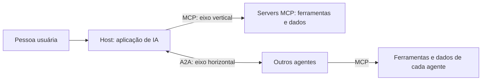

<!-- TOC -->
<!-- TOC -->

# Protocolos de comunicação para sistemas de IA

Material de estudo em português sobre como modelos e agentes de IA se conectam a ferramentas, dados e outros agentes por meio de protocolos abertos. O foco está em **MCP** (Model Context Protocol) e **A2A** (Agent-to-Agent), do problema que motivou esses protocolos até a operação segura em produção.



- **MCP** padroniza o acesso de um agente a ferramentas e dados.
- **A2A** padroniza a colaboração entre agentes autônomos.

## Por onde começar

- **Não é da área técnica?** Comece pelo [Guia para leigos](docs/guia-para-leigos.md), com analogias, diagramas e glossário.
- **Quer o panorama técnico?** Leia [Fundamentos](docs/fundamentos.md) e siga a trilha abaixo.

## Trilha de leitura

A ordem sugerida parte do problema, passa pela arquitetura e chega à construção e à operação.

| # | Documento | Pergunta que responde | Laboratório |
| --- | --- | --- | --- |
| 1 | [Fundamentos](docs/fundamentos.md) | Qual é o panorama completo do tema? | 15 |
| 2 | [O caos das integrações](docs/o-caos-das-integracoes.md) | Por que precisamos de protocolos para IA? | 01 |
| 3 | [Wire format e JSON-RPC](docs/wire-format-json-rpc.md) | Como é, de fato, a mensagem trocada entre os sistemas? | 02 |
| 4 | [Tool calling vs. MCP vs. A2A](docs/tool-calling-vs-mcp-a2a.md) | Qual camada usar em cada situação? | 03 |
| 5 | [Host, client e server](docs/host-client-server.md) | Quem faz o quê na arquitetura do MCP? | 04 |
| 6 | [Primitivos do MCP](docs/primitivos-mcp.md) | Quando modelar uma capacidade como resource ou como tool? | 05 |
| 7 | [Prompts e sampling](docs/prompt-sampling.md) | Como o server orienta a interação e pede ajuda ao modelo? | 06 |
| 8 | [Operação do ecossistema MCP](docs/operacao-ecossistema-mcp.md) | Como conectar, inspecionar e depurar servers existentes? | 07 |
| 9 | [McpServer em TypeScript](docs/mcpserver.md) | Como construir um server com o SDK em TypeScript? | 08 |
| 10 | [MCPServer em Python (antigo FastMCP)](docs/fastmcp.md) | Como construir um server de negócio em Python, pronto para operar? | 09 |
| 11 | [Segurança em camadas](docs/seguranca-camada.md) | Como proteger e colocar um server em produção? | 10, 11 e 12 |
| 12 | [Agent-to-Agent (A2A)](docs/agent-to-agent.md) | Como agentes autônomos descobrem uns aos outros e colaboram? | 13 e 14 |

## Laboratórios

Cada conteúdo que pode ser demonstrado com código tem um laboratório executável em Python e Docker Compose. Os labs são didáticos e não estão prontos para produção.

### Preparar o ambiente

Os sistemas suportados são Ubuntu 22.04, 24.04 e 26.04 (amd64) e macOS (amd64 e arm64). Os detalhes estão em [REQUIREMENTS.md](REQUIREMENTS.md).

```bash
make check-os              # confere o sistema
make install-dependencies  # instala Docker e mise, após confirmação (DRY_RUN=1 só mostra os comandos)
make install               # instala Python, uv e Node.js do mise.toml e cria o .env
make check-dependencies    # confere tudo
make lab-list              # lista os labs
```

### Configurar as variáveis de ambiente

As variáveis ficam no `.env`, que está fora do Git. O arquivo versionado é o [.env.example](.env.example), com os padrões e os comentários.

1. `make install` cria o `.env`. Para criá-lo sozinho, use `make secret`.
2. `make secret` gera os segredos locais marcados como `CHANGEME`, como a senha do Grafana.
3. Chaves de terceiros nunca são geradas. Só as preencha se for usar um provedor real.
4. `make check-env LAB=NN` confere o que o lab exige, e `make lab-start` faz isso automaticamente.

| Variável | Padrão | Função |
| --- | --- | --- |
| `GRAFANA_PORT`, `PROMETHEUS_PORT`, `JAEGER_UI_PORT`, `LOKI_PORT` | `3000`, `9090`, `16686`, `3100` | Portas publicadas em `127.0.0.1` |
| `LAB_SERVICE_PORT` | `8000` | Porta do serviço principal do lab |
| `GRAFANA_ADMIN_USER` e `GRAFANA_ADMIN_PASSWORD` | `admin` e `CHANGEME` | Login do Grafana |
| `POSTGRES_PASSWORD` | `CHANGEME` | Banco dos labs 07, 08, 09 e 15 |
| `KEYCLOAK_ADMIN_PASSWORD` e `KEYCLOAK_DEMO_PASSWORD` | `CHANGEME` | Keycloak do lab 11 |
| `MCP_BEARER_TOKEN` | `CHANGEME` | Token de serviço dos labs 12 e 15 |
| `LLM_PROVIDER` e `LLM_MODEL` | `fake` e vazio | Provedor de LLM. Com `fake`, nenhum lab precisa de chave |
| `ANTHROPIC_API_KEY`, `OPENAI_API_KEY`, `GEMINI_API_KEY` | `CHANGEME` | Opcionais, usadas só com o provedor correspondente |

Se uma porta estiver ocupada, `make lab-start` avisa antes de subir; basta mudar a variável correspondente no `.env`.

### Iniciar, executar e parar cada lab

Execute um lab com stack por vez, pois eles usam as mesmas portas.

| Lab | Conteúdo | Stack | Iniciar | Executar | Parar |
| --- | --- | --- | --- | --- | --- |
| 01 | [O problema N×M: uma tool em cada formato](labs/lab-01-nxm/README.md) | Não | `make lab-start LAB=01` | `make lab-run LAB=01` | `make lab-stop LAB=01` |
| 02 | [Mensagens JSON-RPC brutas em stdio e HTTP](labs/lab-02-json-rpc/README.md) | Não | `make lab-start LAB=02` | `make lab-run LAB=02` | `make lab-stop LAB=02` |
| 03 | [Tool calling, MCP e A2A lado a lado](labs/lab-03-camadas/README.md) | Sim | `make lab-start LAB=03` | `make lab-run LAB=03` | `make lab-stop LAB=03` |
| 04 | [Host, client, server e circuit breaker](labs/lab-04-host-client-server/README.md) | Sim | `make lab-start LAB=04` | `make lab-run LAB=04` | `make lab-stop LAB=04` |
| 05 | [Resources, tools e prompts](labs/lab-05-primitivos/README.md) | Sim | `make lab-start LAB=05` | `make lab-run LAB=05` | `make lab-stop LAB=05` |
| 06 | [Prompts, inferência e limite de recursão](labs/lab-06-prompts-inferencia/README.md) | Sim | `make lab-start LAB=06` | `make lab-run LAB=06` | `make lab-stop LAB=06` |
| 07 | [Fanout, descoberta e eras do protocolo](labs/lab-07-ecossistema/README.md) | Sim | `make lab-start LAB=07` | `make lab-run LAB=07` | `make lab-stop LAB=07` |
| 08 | [Server em TypeScript e client em Python](labs/lab-08-sdk-typescript/README.md) | Sim | `make lab-start LAB=08` | `make lab-run LAB=08` | `make lab-stop LAB=08` |
| 09 | [Finance Admin: regra de negócio e erros](labs/lab-09-finance-admin/README.md) | Sim | `make lab-start LAB=09` | `make lab-run LAB=09` | `make lab-stop LAB=09` |
| 10 | [Injeção indireta e dados adulterados](labs/lab-10-injecao/README.md) | Sim | `make lab-start LAB=10` | `make lab-run LAB=10` | `make lab-stop LAB=10` |
| 11 | [OAuth 2.1 com Keycloak](labs/lab-11-oauth/README.md) | Sim | `make lab-start LAB=11` | `make lab-run LAB=11` | `make lab-stop LAB=11` |
| 12 | [Produção como evidência](labs/lab-12-producao/README.md) | Sim | `make lab-start LAB=12` | `make lab-run LAB=12` | `make lab-stop LAB=12` |
| 13 | [Ciclo de vida de Tasks do A2A](labs/lab-13-a2a-tasks/README.md) | Sim | `make lab-start LAB=13` | `make lab-run LAB=13` | `make lab-stop LAB=13` |
| 14 | [Delegado, hierárquico e pipeline](labs/lab-14-a2a-padroes/README.md) | Sim | `make lab-start LAB=14` | `make lab-run LAB=14` | `make lab-stop LAB=14` |
| 15 | [Assistente de pós-venda ponta a ponta](labs/lab-15-integrador/README.md) | Sim | `make lab-start LAB=15` | `make lab-run LAB=15` | `make lab-stop LAB=15` |

Todos aceitam também estes alvos:

```bash
make lab-logs LAB=09                  # acompanha os logs; SERVICE=server filtra por serviço
make lab-status LAB=09                # mostra o estado dos containers
make lab-clean LAB=09                 # remove containers, volumes e imagens do lab
make lab-test LAB=09                  # executa os testes, sem Docker
make lab-smoke LAB=09                 # sobe, executa, confere a telemetria e remove tudo
```

### Observar métricas, traces e logs

Os labs com stack incluem Prometheus, Grafana, Jaeger, Loki e OpenTelemetry Collector, em versões fixas. O [README da stack de observabilidade](labs/observability/README.md) explica, com diagramas e analogias, como funciona a coleta de métricas, traces e logs e como ler os dashboards.

| Ferramenta | Endereço | Para quê |
| --- | --- | --- |
| Grafana | <http://localhost:3000> | Dashboard do lab e correlação entre os sinais |
| Jaeger | <http://localhost:16686> | Busca e leitura de traces |
| Prometheus | <http://localhost:9090> | Consulta de métricas |

No dashboard do lab, clique em um exemplar de um gráfico para abrir o trace. No trace, use **Logs for this span** para ler os logs e **Operações por segundo** para voltar às métricas. Em uma linha de log, o campo `trace_id` abre o trace.

O Grafana roda com o novo visual, notebooks, variáveis entre dashboards e o novo painel de texto, recursos em preview ou experimentais da versão 13.3. O datasource do Grafana ainda não busca traces no Jaeger 2.22, então a busca por serviço é feita na interface do Jaeger.

### Qualidade

```bash
make lint   # ruff, mypy e shellcheck
make test   # testes de todo o workspace
```

## Guia para leigos

O [Guia para leigos](docs/guia-para-leigos.md) explica os mesmos conceitos com analogias do dia a dia e diagramas:

- [A ideia em um minuto](docs/guia-para-leigos.md#a-ideia-em-um-minuto)
- [O problema: a gaveta de carregadores](docs/guia-para-leigos.md#1-o-problema-a-gaveta-de-carregadores)
- [Três formas de dar capacidades à IA](docs/guia-para-leigos.md#2-três-formas-de-dar-capacidades-à-ia)
- [O restaurante: host, client e server](docs/guia-para-leigos.md#3-o-restaurante-host-client-e-server)
- [Olhos, mãos e roteiro: resources, tools e prompts](docs/guia-para-leigos.md#4-olhos-mãos-e-roteiro-resources-tools-e-prompts)
- [Sampling: a cozinha pede uma segunda opinião](docs/guia-para-leigos.md#5-sampling-a-cozinha-pede-uma-segunda-opinião)
- [JSON-RPC: a comanda padronizada](docs/guia-para-leigos.md#6-json-rpc-a-comanda-padronizada)
- [Cada pedido é uma carta completa](docs/guia-para-leigos.md#7-cada-pedido-é-uma-carta-completa)
- [Construindo um server: a loja com regras claras](docs/guia-para-leigos.md#8-construindo-um-server-a-loja-com-regras-claras)
- [Segurança: o prédio com várias portarias](docs/guia-para-leigos.md#9-segurança-o-prédio-com-várias-portarias)
- [A2A: a equipe de especialistas](docs/guia-para-leigos.md#10-a2a-a-equipe-de-especialistas)
- [Tudo junto: um assistente de pós-venda](docs/guia-para-leigos.md#11-tudo-junto-um-assistente-de-pós-venda)
- [Tabela de analogias](docs/guia-para-leigos.md#tabela-de-analogias)
- [Glossário](docs/guia-para-leigos.md#glossário)

## Versões de referência

Os documentos foram atualizados com base nas fontes oficiais consultadas em 2026-11-02, nestas versões:

| Tecnologia | Versão |
| --- | --- |
| MCP | Revisão 2026-07-28 |
| A2A | 1.0.0 |
| SDK do MCP em TypeScript | `v2.4.0` |
| SDK do MCP em Python | `v2.3.0` |
| SDK do A2A em Python | `1.3.0` |
| Grafana | `13.3.0` |
| Prometheus | `v3.15.1` |
| Jaeger | `2.22.0` |
| Loki | `3.7.9` |
| OpenTelemetry Collector | `0.164.0` |

Em relação às versões anteriores, as principais mudanças são:

- O MCP deixou de ter o handshake `initialize` e sessões de protocolo.
- Sampling, Roots e Logging do MCP estão marcados como *Deprecated*.
- O `FastMCP` do SDK em Python agora se chama `MCPServer`.
- O A2A adotou nomes como `TASK_STATE_INPUT_REQUIRED` e `SendMessage`.

## Manutenção

Para propor uma alteração, siga o [guia de contribuição](CONTRIBUTING.md). As regras completas para editar o conteúdo, os diagramas e este README estão em [CLAUDE.md](CLAUDE.md). As mudanças de cada versão estão em [CHANGELOG.md](CHANGELOG.md).

## Referências

- [Especificação do MCP, revisão 2026-07-28](https://modelcontextprotocol.io/specification/2026-07-28)
- [Mudanças da revisão 2026-07-28 do MCP](https://modelcontextprotocol.io/specification/2026-07-28/changelog)
- [Especificação do A2A, versão 1.0.0](https://a2a-protocol.org/v1.0.0/specification/)
- [Especificação do JSON-RPC 2.0](https://www.jsonrpc.org/specification)
- [SDK oficial do MCP em TypeScript](https://github.com/modelcontextprotocol/typescript-sdk)
- [SDK oficial do MCP em Python](https://github.com/modelcontextprotocol/python-sdk)
- [What's new in Grafana v13.3](https://grafana.com/docs/grafana/latest/whatsnew/whats-new-in-v13/whats-new-in-v13-3/)
- [Jaeger: primeiros passos](https://www.jaegertracing.io/docs/latest/getting-started/)
- [Prometheus](https://prometheus.io/docs/introduction/overview/)
- [Loki: envio de dados por OTLP](https://grafana.com/docs/loki/latest/send-data/otel/)
- [OpenTelemetry Collector](https://opentelemetry.io/docs/collector/)

## Desenvolvedor

- Aécio Pires — [Linktree](https://linktr.ee/aeciopires)

## Licença

GPLv3. Consulte o arquivo [LICENSE](./LICENSE) para mais detalhes.
