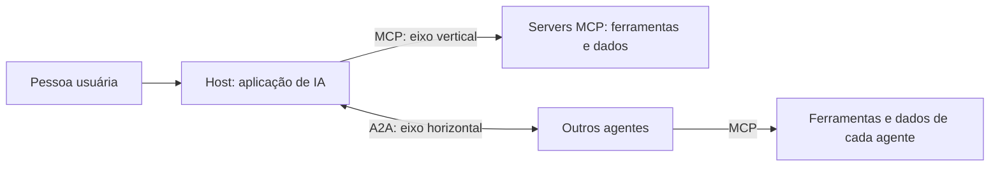

<!-- TOC -->
<!-- TOC -->

# Protocolos de comunicação para sistemas de IA

Material de estudo em português sobre como modelos e agentes de IA se conectam a ferramentas, dados e outros agentes por meio de protocolos abertos. O foco está em **MCP** (Model Context Protocol) e **A2A** (Agent-to-Agent), do problema que motivou esses protocolos até a operação segura em produção.

- **MCP** padroniza o acesso de um agente a ferramentas e dados.
- **A2A** padroniza a colaboração entre agentes autônomos.

## Por onde começar

- **Não é da área técnica?** Comece pelo [Guia para leigos](docs/guia-para-leigos.md), com analogias, diagramas e glossário.
- **Quer o panorama técnico?** Leia [Fundamentos](docs/fundamentos.md) e siga a trilha abaixo.

## Trilha de leitura

A ordem sugerida parte do problema, passa pela arquitetura e chega à construção e à operação.

| # | Documento | Pergunta que responde |
| --- | --- | --- |
| 1 | [Fundamentos](docs/fundamentos.md) | Qual é o panorama completo do tema? |
| 2 | [O caos das integrações](docs/o-caos-das-integracoes.md) | Por que precisamos de protocolos para IA? |
| 3 | [Wire format e JSON-RPC](docs/wire-format-json-rpc.md) | Como é, de fato, a mensagem trocada entre os sistemas? |
| 4 | [Tool calling vs. MCP vs. A2A](docs/tool-calling-vs-mcp-a2a.md) | Qual camada usar em cada situação? |
| 5 | [Host, client e server](docs/host-client-server.md) | Quem faz o quê na arquitetura do MCP? |
| 6 | [Primitivos do MCP](docs/primitivos-mcp.md) | Quando modelar uma capacidade como resource ou como tool? |
| 7 | [Prompts e sampling](docs/prompt-sampling.md) | Como o server orienta a interação e pede ajuda ao modelo? |
| 8 | [Operação do ecossistema MCP](docs/operacao-ecossistema-mcp.md) | Como conectar, inspecionar e depurar servers existentes? |
| 9 | [McpServer em TypeScript](docs/mcpserver.md) | Como construir um server com o SDK em TypeScript? |
| 10 | [MCPServer em Python (antigo FastMCP)](docs/fastmcp.md) | Como construir um server de negócio em Python, pronto para operar? |
| 11 | [Segurança em camadas](docs/seguranca-camada.md) | Como proteger e colocar um server em produção? |
| 12 | [Agent-to-Agent (A2A)](docs/agent-to-agent.md) | Como agentes autônomos descobrem uns aos outros e colaboram? |

O repositório contém apenas textos. Os documentos citam laboratórios e arquivos, como `verify_lab.sh` e `mcp-catalog.yaml`, que **não estão incluídos aqui**.

## Guia para leigos

O [Guia para leigos](docs/guia-para-leigos.md) explica os mesmos conceitos com analogias do dia a dia e diagramas:

- [A ideia em um minuto](docs/guia-para-leigos.md#a-ideia-em-um-minuto)
- [O problema: a gaveta de carregadores](docs/guia-para-leigos.md#1-o-problema-a-gaveta-de-carregadores)
- [Três formas de dar capacidades à IA](docs/guia-para-leigos.md#2-três-formas-de-dar-capacidades-à-ia)
- [O restaurante: host, client e server](docs/guia-para-leigos.md#3-o-restaurante-host-client-e-server)
- [Olhos, mãos e roteiro: resources, tools e prompts](docs/guia-para-leigos.md#4-olhos-mãos-e-roteiro-resources-tools-e-prompts)
- [Sampling: a cozinha pede uma segunda opinião](docs/guia-para-leigos.md#5-sampling-a-cozinha-pede-uma-segunda-opinião)
- [JSON-RPC: a comanda padronizada](docs/guia-para-leigos.md#6-json-rpc-a-comanda-padronizada)
- [Cada pedido é uma carta completa](docs/guia-para-leigos.md#7-cada-pedido-é-uma-carta-completa)
- [Construindo um server: a loja com regras claras](docs/guia-para-leigos.md#8-construindo-um-server-a-loja-com-regras-claras)
- [Segurança: o prédio com várias portarias](docs/guia-para-leigos.md#9-segurança-o-prédio-com-várias-portarias)
- [A2A: a equipe de especialistas](docs/guia-para-leigos.md#10-a2a-a-equipe-de-especialistas)
- [Tudo junto: um assistente de pós-venda](docs/guia-para-leigos.md#11-tudo-junto-um-assistente-de-pós-venda)
- [Tabela de analogias](docs/guia-para-leigos.md#tabela-de-analogias)
- [Glossário](docs/guia-para-leigos.md#glossário)

## Versões de referência

Os documentos foram atualizados com base nas fontes oficiais consultadas em 2026-11-02, nestas versões:

| Tecnologia | Versão |
| --- | --- |
| MCP | Revisão 2026-07-28 |
| A2A | 1.0.0 |
| SDK do MCP em TypeScript | `v2.4.0` |
| SDK do MCP em Python | `v2.3.0` |

Em relação às versões anteriores, as principais mudanças são:

- O MCP deixou de ter o handshake `initialize` e sessões de protocolo.
- Sampling, Roots e Logging do MCP estão marcados como *Deprecated*.
- O `FastMCP` do SDK em Python agora se chama `MCPServer`.
- O A2A adotou nomes como `TASK_STATE_INPUT_REQUIRED` e `SendMessage`.

## Manutenção

Para propor uma alteração, siga o [guia de contribuição](CONTRIBUTING.md). As regras completas para editar o conteúdo, os diagramas e este README estão em [CLAUDE.md](CLAUDE.md).

## Referências

- [Especificação do MCP, revisão 2026-07-28](https://modelcontextprotocol.io/specification/2026-07-28)
- [Mudanças da revisão 2026-07-28 do MCP](https://modelcontextprotocol.io/specification/2026-07-28/changelog)
- [Especificação do A2A, versão 1.0.0](https://a2a-protocol.org/v1.0.0/specification/)
- [Especificação do JSON-RPC 2.0](https://www.jsonrpc.org/specification)
- [SDK oficial do MCP em TypeScript](https://github.com/modelcontextprotocol/typescript-sdk)
- [SDK oficial do MCP em Python](https://github.com/modelcontextprotocol/python-sdk)

## Desenvolvedor

- Aécio Pires — [Linktree](https://linktr.ee/aeciopires)

## Licença

GPLv3. Consulte o arquivo [LICENSE](./LICENSE) para mais detalhes.
