<!-- TOC -->
<!-- TOC -->

# Guia para leigos: como as IAs conversam com o mundo

Este guia explica, sem exigir conhecimento de programação, os conceitos do repositório. Cada parte traz uma analogia do dia a dia, um diagrama e um link para o documento técnico correspondente.

Os termos em inglês (como *tool* e *server*) foram mantidos porque são os nomes que você encontrará nos documentos técnicos. Todos estão explicados no [glossário](#glossário).

## A ideia em um minuto

Um modelo de IA, sozinho, é como um consultor muito bem informado trancado em uma sala: sabe conversar, mas não enxerga os dados da sua empresa nem consegue executar nada. Para ser útil, ele precisa de acesso a sistemas e, às vezes, da ajuda de outros especialistas.

**Protocolos** são as regras combinadas que tornam esse acesso possível sem uma gambiarra para cada conexão, assim como a tomada padrão permite ligar qualquer aparelho na parede. Este repositório trata de dois deles:

- **MCP** liga a IA às **ferramentas e aos dados**. Pense em uma tomada universal.
- **A2A** liga uma IA a **outra IA**. Pense em colegas de trabalho que se passam tarefas.

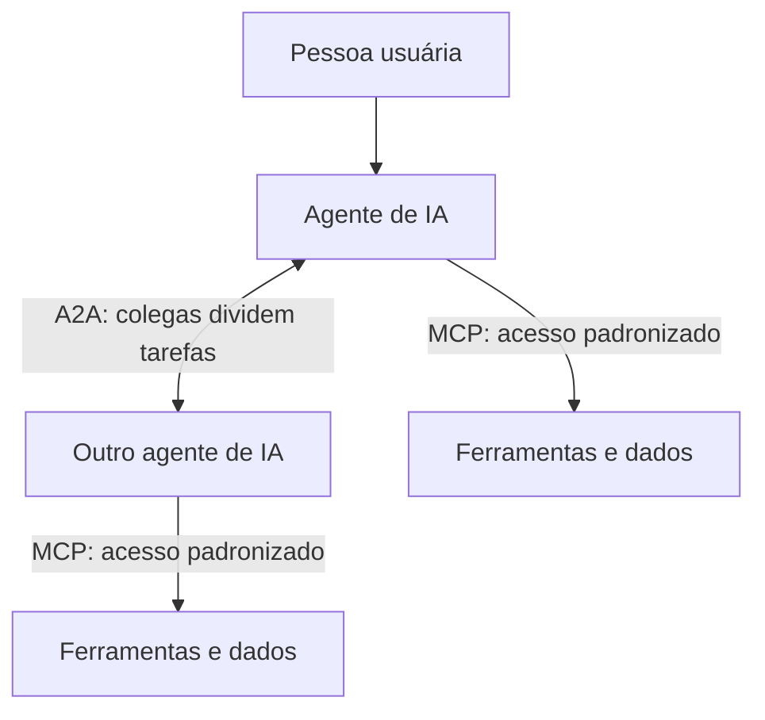

> **Agente** é uma IA que não apenas responde: ela decide passos e usa ferramentas para cumprir um objetivo.

## 1. O problema: a gaveta de carregadores

Lembra da época em que cada celular tinha um carregador diferente? A gaveta ficava cheia de cabos, e trocar de aparelho significava comprar tudo de novo. O USB resolveu isso com um padrão único.

Com a IA acontecia algo parecido. Cada modelo descrevia ferramentas de um jeito próprio, então **cada modelo precisava de um adaptador para cada ferramenta**. Isso é o chamado problema **N por M**.

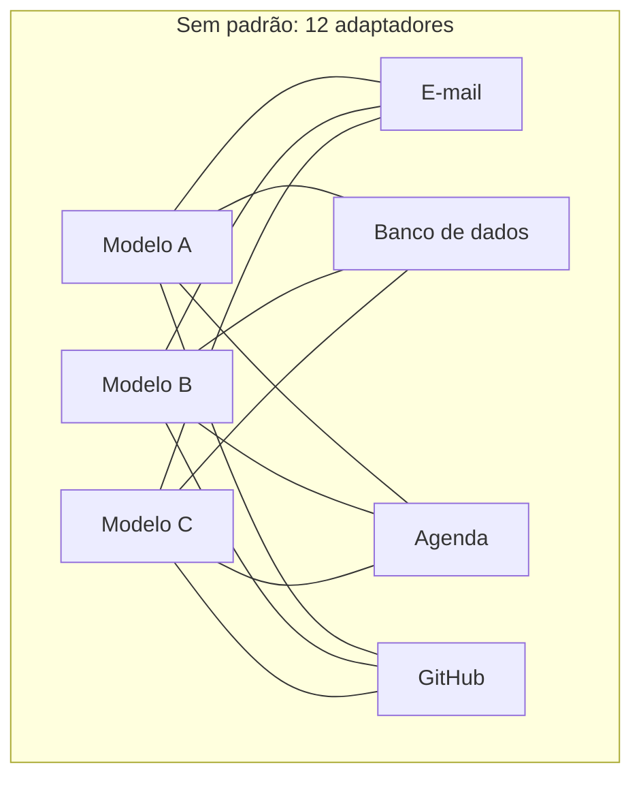

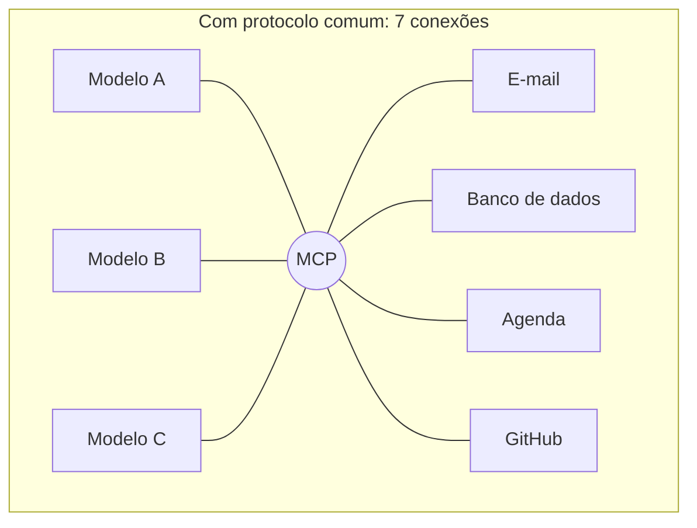

A diferença cresce depressa (os números abaixo são apenas ilustrativos):

| Modelos | Ferramentas | Sem padrão (multiplica) | Com padrão (soma) |
| --- | --- | --- | --- |
| 3 | 4 | 12 | 7 |
| 10 | 20 | 200 | 30 |

Esse emaranhado também gera **lock-in**, a dependência de um fornecedor: mudar fica tão caro que você permanece mesmo sem querer, como quem não troca de marca porque todos os acessórios só servem nela.

**Para aprofundar:** [O caos das integrações](o-caos-das-integracoes.md)

**Experimente:** o [Lab 01: o problema N×M](../labs/lab-01-nxm/README.md) mostra isso funcionando. Um laboratório é um pequeno exemplo executável, e os comandos estão no README dele.

## 2. Três formas de dar capacidades à IA

Imagine que você precisa consertar algo em casa. Há três situações:

| Abordagem | Analogia | Quando faz sentido |
| --- | --- | --- |
| **Tool calling** | O canivete no seu bolso: rápido, mas só você usa | Protótipo simples, com um único fornecedor |
| **MCP** | A ferramenteira do prédio, com catálogo: qualquer morador consulta o que há e pega o que precisa | Várias aplicações ou modelos compartilham a mesma ferramenta |
| **A2A** | Contratar um eletricista: você passa o problema, e ele decide como resolver | O outro lado tem autonomia e inteligência próprias |

Ferramenta **executa uma operação**; agente **conduz uma tarefa**. As três formas não competem e podem conviver no mesmo sistema.

As perguntas abaixo ajudam a escolher:

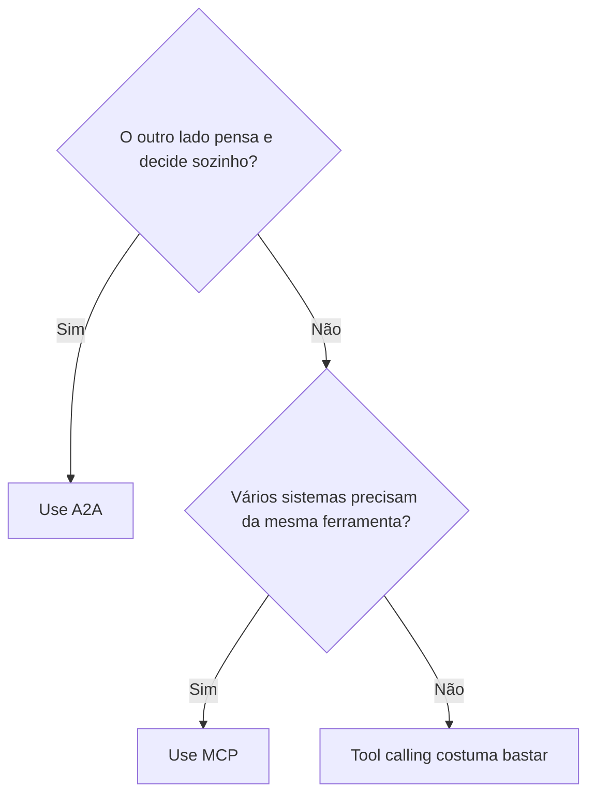

**Para aprofundar:** [Tool calling vs. MCP vs. A2A](tool-calling-vs-mcp-a2a.md)

**Experimente:** o [Lab 03: tool calling, MCP e A2A](../labs/lab-03-camadas/README.md) mostra isso funcionando. Um laboratório é um pequeno exemplo executável, e os comandos estão no README dele.

## 3. O restaurante: host, client e server

O MCP divide o trabalho em três papéis, como um restaurante:

| Papel técnico | No restaurante | O que faz |
| --- | --- | --- |
| **Host** | O freguês na mesa | Decide o que quer. É o aplicativo que você usa, como um assistente ou editor de código |
| **Client** | O garçom | Traduz o pedido para o formato da cozinha, confere se está certo e avisa se algo der errado |
| **Server** | A cozinha | Faz o trabalho real e esconde os detalhes de como faz |

> **Cuidado com a confusão de nomes:** em português, "cliente" lembra o freguês, mas o *client* técnico é o **garçom**.

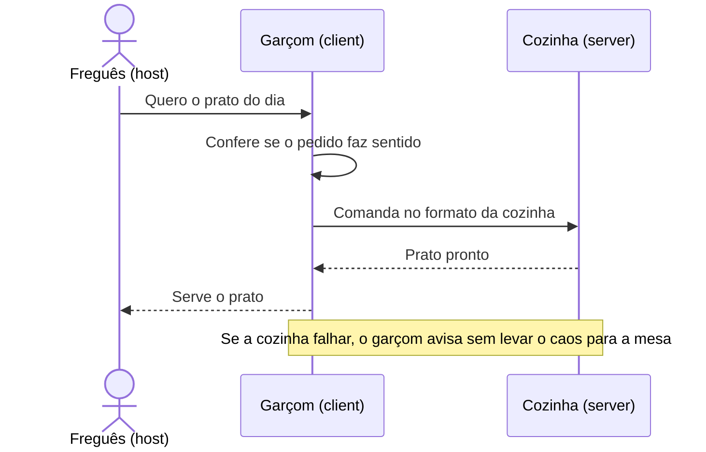

Por que separar? Porque a cozinha pode trocar de fogão sem que o freguês perceba, e o garçom atende qualquer mesa. Na prática, dá para trocar o modelo de IA ou o banco de dados sem reescrever todo o resto.

**Onde a analogia falha:** o host real também manda na casa. Ele escolhe o modelo de IA, define permissões e decide quais servers participam de cada conversa, algo que nenhum freguês faz.

**Para aprofundar:** [Host, client e server](host-client-server.md)

**Experimente:** o [Lab 04: host, client e server](../labs/lab-04-host-client-server/README.md) mostra isso funcionando. Um laboratório é um pequeno exemplo executável, e os comandos estão no README dele.

## 4. Olhos, mãos e roteiro: resources, tools e prompts

Um server oferece três tipos de capacidade, chamados **primitivos**:

| Primitivo | Analogia | Exemplo | Muda alguma coisa? |
| --- | --- | --- | --- |
| **Resource** | Os **olhos** | Consultar um pedido, ler um log | Não, só lê |
| **Tool** | As **mãos** | Enviar um e-mail, cancelar um pedido | Em geral sim, mas também pode calcular ou consultar |
| **Prompt** | O **roteiro** pronto, como um item de menu | "Investigar pedido" com um campo para o número | Não executa nada, só orienta |

A pergunta que decide entre olhos e mãos é simples:

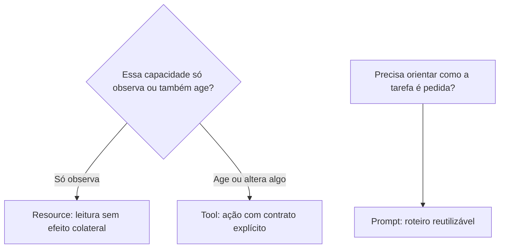

Os três também diferem em **quem decide usar**: a tool é escolhida pela IA, o resource pelo aplicativo e o prompt pela pessoa. Por isso, uma consulta que a própria IA precisa decidir fazer também pode ser uma tool.

Um bom fluxo **olha antes de agir**: primeiro lê o pedido, depois decide e só então executa. Quem precisa só olhar não deveria receber um botão de ação, pois isso aumenta o risco de erro e o custo.

Toda tool tem um **schema**, que funciona como um formulário com campos obrigatórios. Um e-mail exige destinatário, assunto e corpo, e assim a IA não precisa adivinhar o que informar.

**Para aprofundar:** [Primitivos do MCP](primitivos-mcp.md)

**Experimente:** o [Lab 05: resources, tools e prompts](../labs/lab-05-primitivos/README.md) mostra isso funcionando. Um laboratório é um pequeno exemplo executável, e os comandos estão no README dele.

## 5. Sampling: a cozinha pede uma segunda opinião

> **Recurso em aposentadoria:** a [revisão 2026-07-28 do MCP](https://modelcontextprotocol.io/specification/2026-07-28/changelog) marcou o sampling como *Deprecated*. Ele ainda funciona, mas novos projetos não devem adotá-lo. A recomendação é o server chamar diretamente a IA do provedor.

Normalmente o host pede e o server executa. No **sampling**, é o server que precisa da IA no meio do trabalho, usando o modelo controlado pelo host.

Imagine um cozinheiro que encontra um ingrediente com cheiro estranho. Em vez de levar o estoque inteiro ao especialista, ele separa uma amostra e devolve a comanda ao garçom com a pergunta: "isto está bom?". O garçom volta com a mesma comanda e a resposta, e o preparo continua.

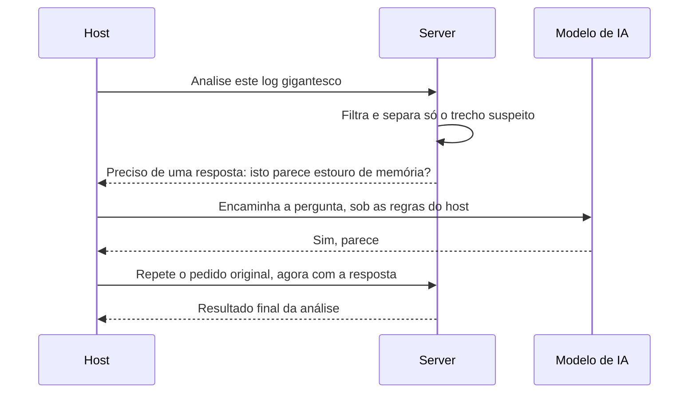

- **Quando recorrer à IA:** para dúvidas de significado que o código não resolve bem, como classificar um texto em linguagem natural.
- **Quando não recorrer:** se a regra cabe em um simples "se isso, então aquilo", o código comum é mais barato, previsível e seguro.
- **O risco:** a IA aciona uma tool, que consulta a IA, que aciona outra tool... É como uma ligação transferida sem parar, com a conta subindo. Por isso são necessários limites de repetição e de custo.

**Para aprofundar:** [Prompts e sampling](prompt-sampling.md)

**Experimente:** o [Lab 06: prompts e inferência](../labs/lab-06-prompts-inferencia/README.md) mostra isso funcionando. Um laboratório é um pequeno exemplo executável, e os comandos estão no README dele.

## 6. JSON-RPC: a comanda padronizada

Para que todos se entendam, as mensagens seguem um formato chamado **JSON-RPC 2.0**. Pense em uma comanda de restaurante com campos fixos:

```json
{
  "jsonrpc": "2.0",
  "id": 7,
  "method": "tools/call",
  "params": {
    "name": "consultar_pedido",
    "arguments": { "pedido_id": 123 }
  }
}
```

O exemplo está resumido. Na versão atual do MCP, cada pedido também leva, em um campo chamado `_meta`, a versão do protocolo e o que o client sabe fazer.

| Campo | Na comanda | Significado |
| --- | --- | --- |
| `jsonrpc` | Modelo do formulário | Versão do protocolo |
| `id` | Número da comanda | Liga a resposta ao pedido certo |
| `method` | Tipo de serviço | Qual operação executar |
| `params` | Itens do pedido | Dados necessários |

Existem três tipos de mensagem:

| Tipo | Analogia | Tem `id`? |
| --- | --- | --- |
| **Request** | Fazer um pedido e aguardar | Sim |
| **Response** | Receber o pedido feito, ou um aviso de que não deu certo | Sim, o mesmo do pedido |
| **Notification** | Aviso no alto-falante, sem resposta esperada | Não |

O número da comanda permite que os pedidos fiquem prontos fora de ordem, como em uma padaria que chama as senhas conforme saem do forno:

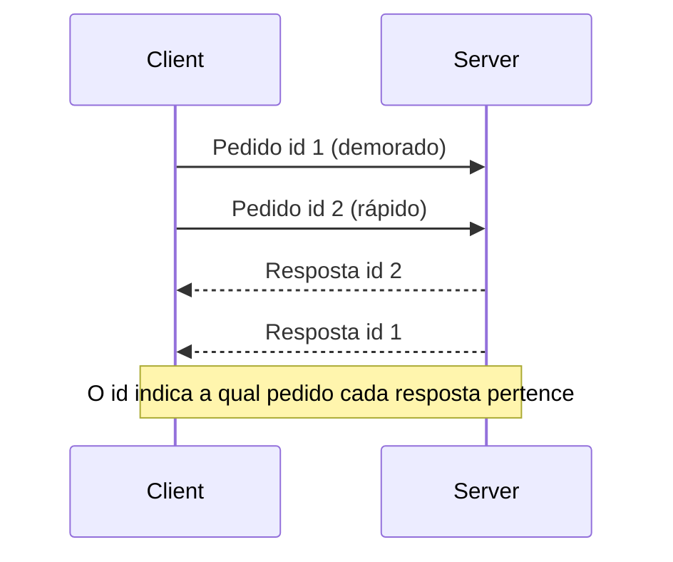

Os erros também são padronizados, o que transforma um vago "deu erro" em uma pista concreta:

| Código | Nome técnico | Tradução para o dia a dia |
| --- | --- | --- |
| `-32700` | Parse error | A comanda está ilegível |
| `-32600` | Invalid request | A comanda não segue o formato |
| `-32601` | Method not found | Esse serviço não existe aqui |
| `-32602` | Invalid params | O pedido está malformado, ou a tool pedida não existe |
| `-32603` | Internal error | Algo quebrou na cozinha |

Nem todo problema vira um desses códigos. Quando a comanda está certa, mas a cozinha avisa "acabou o peixe, escolha outro prato", a resposta chega normalmente com a marca `isError: true`. Assim a IA lê o motivo e pode corrigir o pedido.

**Para aprofundar:** [Wire format e JSON-RPC](wire-format-json-rpc.md)

**Experimente:** o [Lab 02: JSON-RPC bruto](../labs/lab-02-json-rpc/README.md) mostra isso funcionando. Um laboratório é um pequeno exemplo executável, e os comandos estão no README dele.

## 7. Cada pedido é uma carta completa

Até a revisão 2025-11-25, o MCP funcionava como um telefonema: primeiro os dois lados se apresentavam (`initialize`), depois conversavam e, por fim, desligavam.

Desde a revisão 2026-07-28, ele funciona como **cartas completas**. Cada pedido informa sozinho a versão do protocolo e o que o remetente sabe fazer. O server não precisa lembrar de nada anterior, e qualquer cópia dele pode responder.

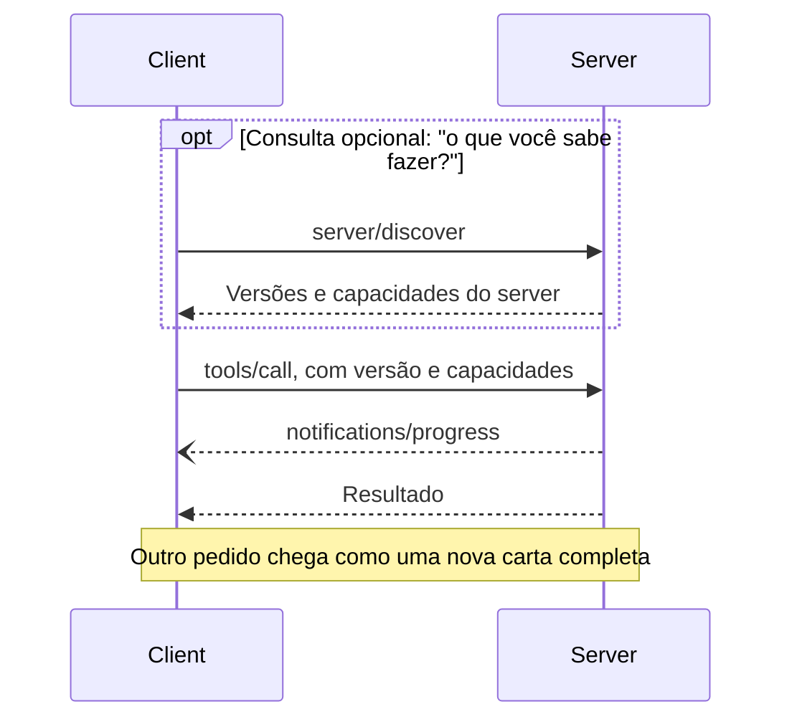

- **O que não foi anunciado não existe.** Se algo não está no cardápio, o outro lado não deve pedir.
- **Versão incompatível:** o server recusa e lista as versões que aceita (erro `-32022`), e o client tenta novamente.
- **Progresso** evita que uma tarefa demorada pareça travada, como acompanhar uma encomenda.
- **Cancelamento e prazo máximo** evitam gastar recursos com algo de que ninguém mais precisa.
- **MCP Inspector** é como o aparelho que o mecânico conecta ao carro: mostra o que realmente está acontecendo, sem depender de qual aplicativo está em uso.

Muitos servers e aplicativos ainda usam a forma antiga, e os SDKs atuais conseguem atender às duas.

**Para aprofundar:** [Operação do ecossistema MCP](operacao-ecossistema-mcp.md)

**Experimente:** o [Lab 07: ecossistema MCP](../labs/lab-07-ecossistema/README.md) mostra isso funcionando. Um laboratório é um pequeno exemplo executável, e os comandos estão no README dele.

## 8. Construindo um server: a loja com regras claras

Montar um server é como abrir uma loja com três peças bem separadas:

| Peça | Na loja | Função |
| --- | --- | --- |
| **Server** | A loja e seu catálogo | Reúne o que é oferecido |
| **Schema** | O atendente que confere o formulário na entrada | Barra dados inválidos antes de chegarem ao estoque |
| **Transport** | O canal de atendimento | **STDIO** é o balcão, na mesma máquina; **Streamable HTTP** é a entrega pela rede |

Os documentos mostram dois caminhos para construir essa loja. O [SDK em TypeScript](mcpserver.md), com `McpServer`, deixa as peças bem à vista. O [`MCPServer` em Python](fastmcp.md), chamado `FastMCP` em versões antigas, preenche boa parte da papelada sozinho, a partir da própria descrição da função. O protocolo é o mesmo nos dois.

### Regra de negócio não é sugestão

O exemplo mais didático do repositório é o da retenção de clientes: o bônus não pode passar de **20% do valor do pedido**. É como um caixa cujo sistema simplesmente não aceita um desconto acima do limite, por mais convincente que seja o pedido.

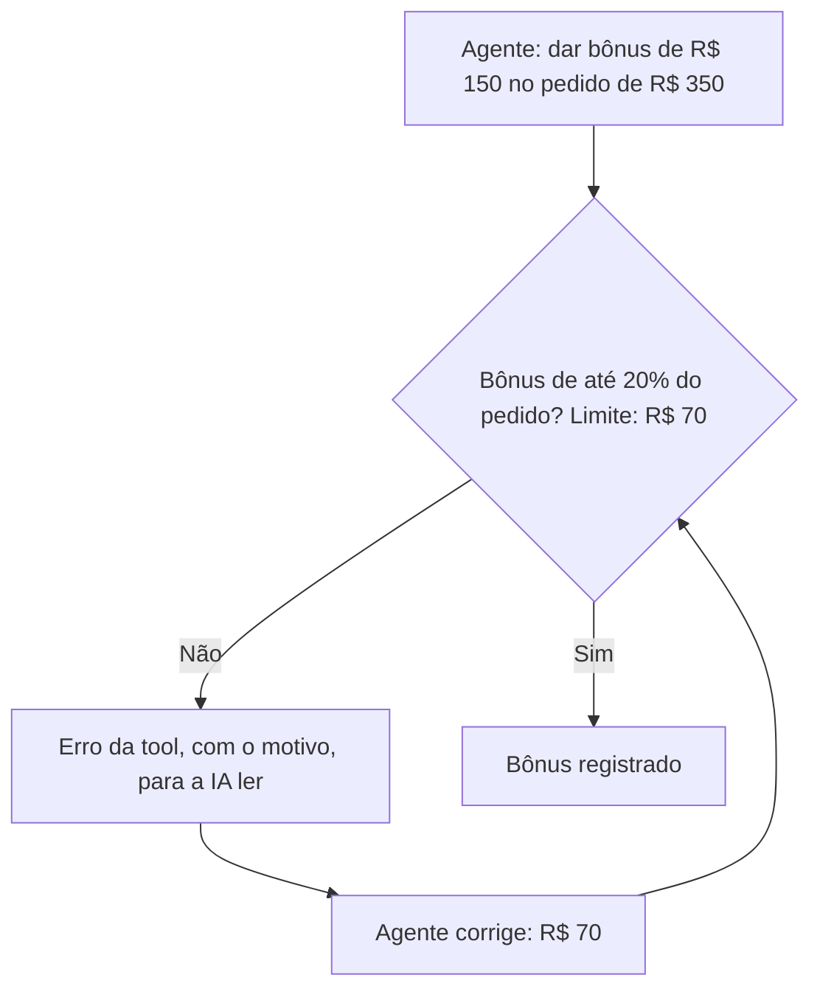

A regra fica no **código do server**, não em um pedido educado à IA. Assim ela vale mesmo que a IA se engane. E o erro não é um beco sem saída: como ele é claro, o agente consegue corrigir o rumo.

### Um server pronto para o trabalho real

Um protótipo pode funcionar em silêncio, mas um serviço de verdade precisa comunicar o que está acontecendo:

- **Erros tipados:** dizem o que deu errado, como uma etiqueta de "endereço incompleto" em vez de "falhou".
- **Logs estruturados:** funcionam como o diário de bordo da operação, sem dados pessoais nem senhas. Hoje a recomendação é gravá-los em `stderr` ou usar OpenTelemetry, pois o recurso de logging do próprio MCP foi marcado como *Deprecated*.
- **Progresso:** mostra "item 3 de 10" para indicar que o trabalho continua vivo.

Um detalhe traiçoeiro: no STDIO, usar `print` para anotar algo é como rabiscar na comanda oficial, porque mistura anotações com o protocolo e pode corromper a comunicação.

**Para aprofundar:** [`McpServer` em TypeScript](mcpserver.md) e [`MCPServer` em Python](fastmcp.md)

**Experimente:** o [Lab 09: Finance Admin](../labs/lab-09-finance-admin/README.md) mostra isso funcionando. Um laboratório é um pequeno exemplo executável, e os comandos estão no README dele.

## 9. Segurança: o prédio com várias portarias

Na segurança tradicional, a preocupação principal é a porta: quem entra e por onde. Com agentes, surge um novo risco, o de **enganar a IA com palavras**, já que ela lê textos e pode agir com base neles.

### Os ataques

| Ataque | Analogia | Exemplo |
| --- | --- | --- |
| **Indirect Prompt Injection** | Um bilhete escondido em uma carta dizendo à secretária: "ignore seu chefe e faça isto" | Uma reclamação de cliente que contém "ignore as instruções anteriores" |
| **Tool Poisoning** | Trocar a etiqueta de preço na prateleira: o caixa age corretamente, mas com base em um dado falso | Um produto de 10 mil reais aparece custando 1 real |

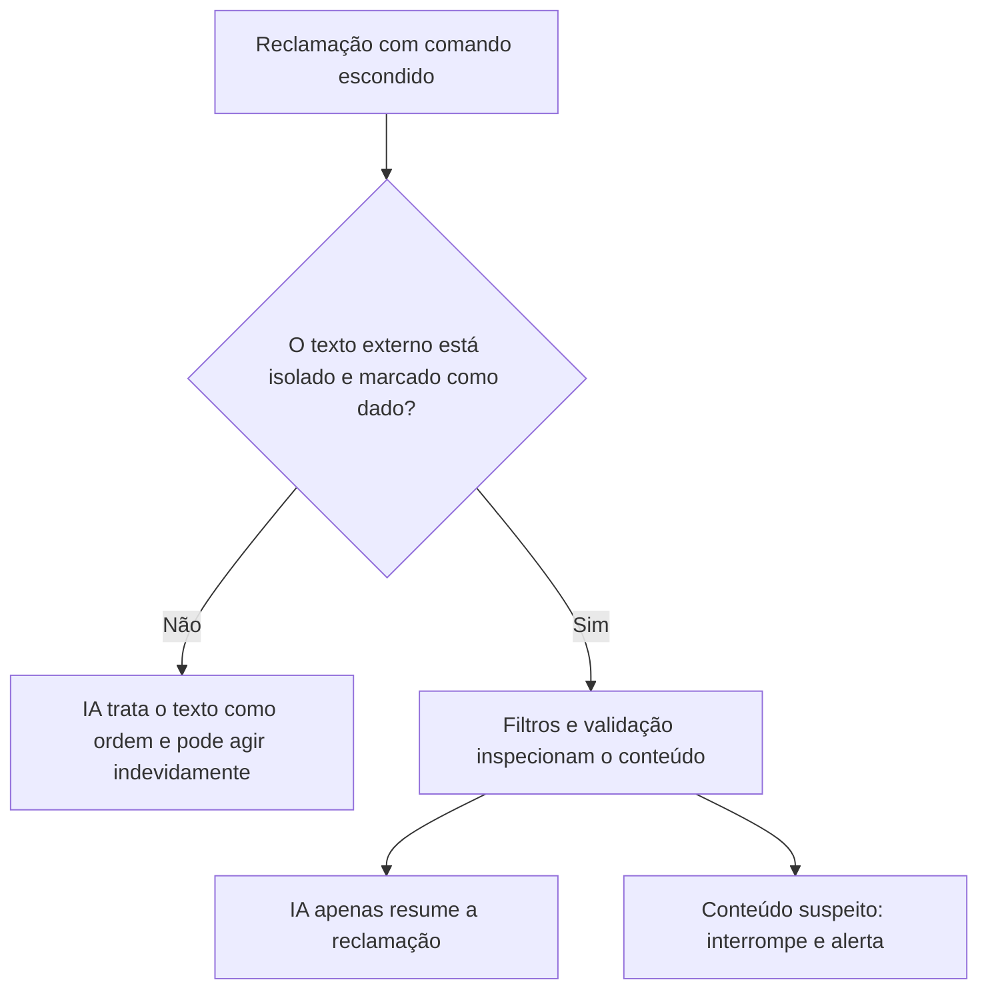

### As defesas em camadas

Como em um prédio com portaria, crachá e cofre, nenhuma barreira é perfeita sozinha. Se uma falhar, as outras ainda protegem. Isso se chama **defesa em profundidade**.

| Defesa | Analogia | O que faz |
| --- | --- | --- |
| **Privilégio mínimo** | O crachá só abre as salas necessárias | A IA não consegue usar o que não existe para ela |
| **Validação de contrato** | Conferir a mercadoria ao receber | Dado fora do formato é descartado |
| **Circuit breaker** | O disjuntor da casa | Corta o fluxo ao detectar anomalia |
| **OAuth 2.1 e scopes** | O cartão de hotel: vale por pouco tempo e abre só certas portas | Identidade verificável e permissões limitadas |
| **Container** | Uma sala isolada, com o mínimo necessário | Limita o estrago de uma invasão |
| **Non-root** | O funcionário sem a chave-mestra | O invasor não começa com poder total |
| **Gateway e allowlist** | A portaria com lista de convidados | Só as tools autorizadas passam |
| **Rate limit (erro `429`)** | Controle de lotação | Barra o excesso de requisições |
| **Auditoria** | A caixa-preta do avião | Registra o pedido, o dado recebido e a ação da IA |

### Por que um cartão de hotel, e não uma chave-mestra

Uma **API key** fixa é como uma única chave copiada para todos: ela não diz quem abriu a porta e é difícil de revogar. Já com **OAuth**, a pessoa se identifica na recepção e o aplicativo recebe um cartão temporário, sem nunca entregar a senha ao server.

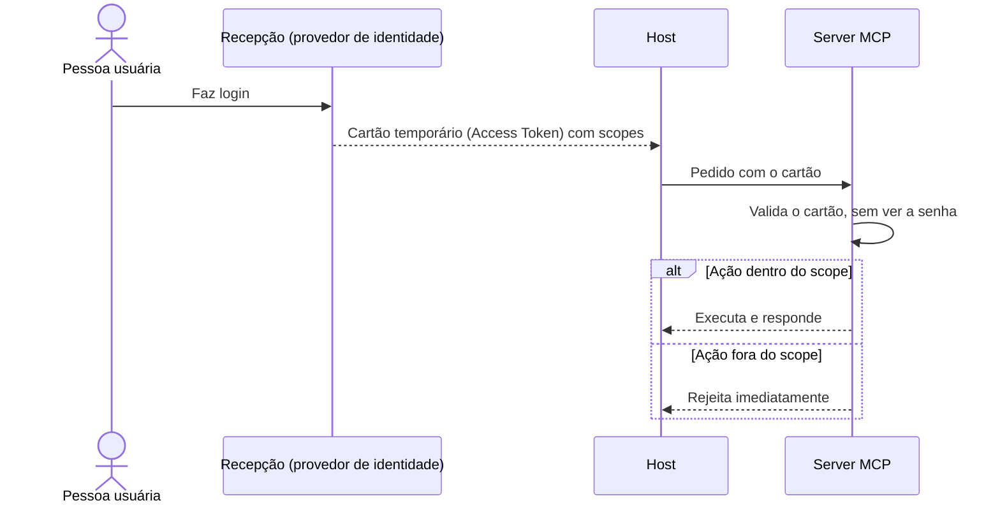

Quando o cartão vence no meio de uma tarefa longa, o **Refresh Token** permite renová-lo sem interromper o trabalho.

### Como tudo fica em produção

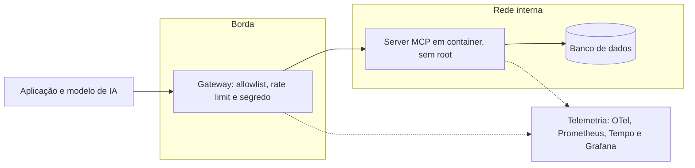

Quando algo falha, existem duas visões do mesmo problema, como em um hospital: a família recebe uma explicação clara, enquanto a equipe médica consulta o prontuário completo. O **cliente** vê uma mensagem limpa, sem detalhes internos. A **engenharia** segue o **trace**, como quem rastreia uma encomenda etapa por etapa, até a linha exata da falha.

> **Produção é evidência, não intenção:** não basta dizer que é seguro; é preciso provar com testes, como verificar que o processo não roda como administrador.

**Para aprofundar:** [Segurança em camadas](seguranca-camada.md)

**Experimente:** o [Lab 10: injeção e dados adulterados](../labs/lab-10-injecao/README.md) mostra isso funcionando. Um laboratório é um pequeno exemplo executável, e os comandos estão no README dele.

## 10. A2A: a equipe de especialistas

Se o MCP é a tomada, o A2A é a forma de **colegas de empresas diferentes trabalharem juntos** sem que precisem usar as mesmas ferramentas internas.

| Conceito | Analogia | Função |
| --- | --- | --- |
| **Agent Card** | Cartão de visita | Diz quem é o agente, o que sabe fazer e como contratá-lo |
| **Task** | Ordem de serviço na oficina | Registra o trabalho, com número e situação, e pode durar bastante |
| **Message** | A conversa com o mecânico | Tira dúvidas e dá avisos ao longo do serviço |
| **Part** | Os anexos de uma conversa | Texto, arquivo ou dados estruturados na mesma mensagem |
| **Artifact** | O carro pronto, com a nota | A entrega formal e reutilizável, separada da conversa |

### A vida de uma Task

O diagrama mostra os caminhos típicos, com os nomes oficiais da [especificação 1.0.0 do A2A](https://a2a-protocol.org/v1.0.0/specification/):

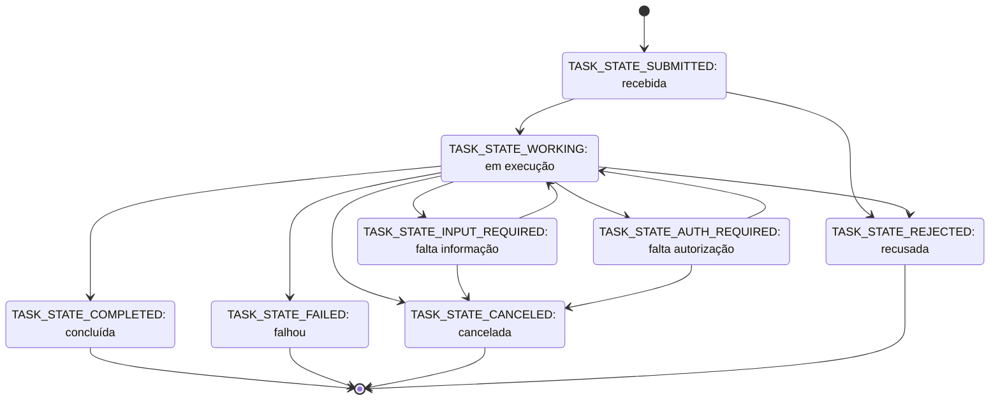

Depois de encerrada, uma Task não volta a andar. É como uma ordem de serviço já fechada: para refazer o trabalho, abre-se outra, no mesmo contexto.

### Pausar para perguntar é um recurso, não uma falha

Se a oficina encontra um problema não previsto, o mecânico liga antes de trocar a peça cara, em vez de adivinhar. O agente deve pausar da mesma forma, em três casos:

| Situação | Exemplo | Por que pausar |
| --- | --- | --- |
| **Campo faltante** | 500 licenças, sem informar a região fiscal | Evita inventar um dado |
| **Ambiguidade** | "Enviar contrato", quando o cliente tem vários | Evita escolher errado |
| **Ação destrutiva** | "Cancelar tudo" | Exige confirmação de uma pessoa |

A regra prática distingue dois casos: **formulário ilegível é recusado** (erro HTTP 400), enquanto **formulário correto com informação de negócio faltando gera uma pergunta** (`TASK_STATE_INPUT_REQUIRED`), mantendo a mesma ordem de serviço.

### Como acompanhar o andamento

| Modo | Analogia | Bom para |
| --- | --- | --- |
| **Espera na chamada** | Esperar no balcão até ficar pronto ou até surgir uma pendência | Tarefas curtas e previsíveis |
| **Consulta periódica (polling)** | Ligar de tempos em tempos para perguntar | Integrações simples, com poucas atualizações |
| **Streaming** | Rastreamento ao vivo da entrega | Acompanhar o progresso em tempo real |
| **Webhook** | "Pode ir embora, nós ligamos quando terminar" | Tarefas longas, sem ninguém esperando |

### Três formas de organizar a equipe

**Delegado: a recepção que encaminha.** Como na recepção de um hospital, alguém identifica o assunto e encaminha ao especialista certo, sem tentar resolver tudo sozinho.

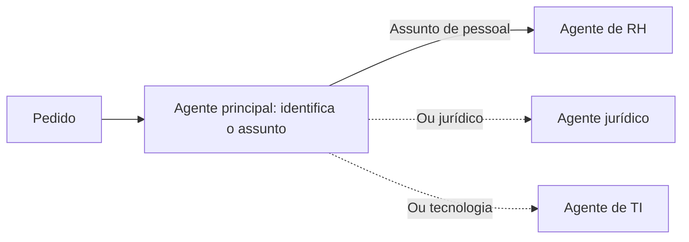

**Hierárquico: a junta de especialistas.** Vários especialistas analisam o mesmo caso ao mesmo tempo, e um coordenador concilia as opiniões em um único parecer. Se um deles ficar indisponível, o coordenador entrega o que tem e avisa o que faltou.

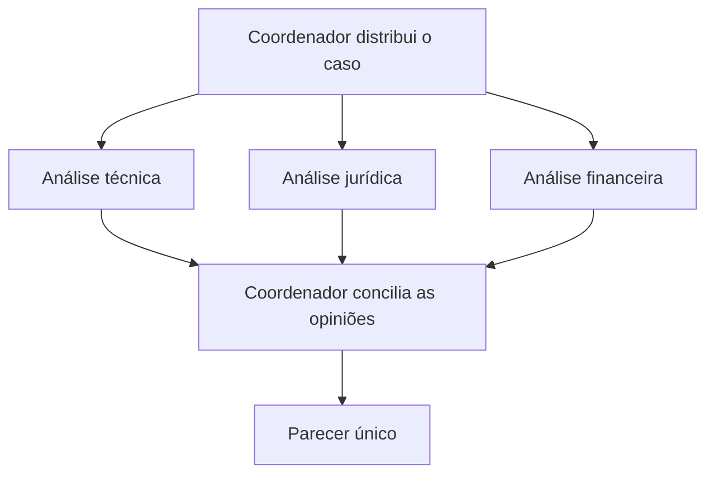

**Pipeline: a linha de montagem.** Cada etapa transforma o material e o passa adiante, em ordem fixa.

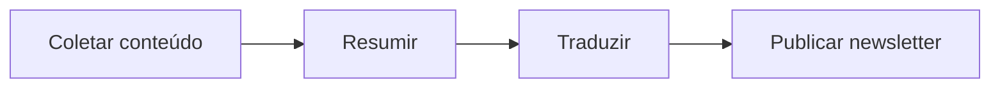

| Se a dificuldade é... | Use |
| --- | --- |
| Decidir **quem** deve cuidar do pedido | Delegado |
| **Combinar opiniões** de várias áreas | Hierárquico |
| Seguir uma **sequência fixa** de transformações | Pipeline |

**Para aprofundar:** [Agent-to-Agent](agent-to-agent.md)

**Experimente:** o [Lab 13: Tasks do A2A](../labs/lab-13-a2a-tasks/README.md) mostra isso funcionando. Um laboratório é um pequeno exemplo executável, e os comandos estão no README dele.

## 11. Tudo junto: um assistente de pós-venda

Veja como as camadas se combinam no cenário de pós-venda usado nos [documentos técnicos](tool-calling-vs-mcp-a2a.md#coexistência-em-uma-mesma-arquitetura):

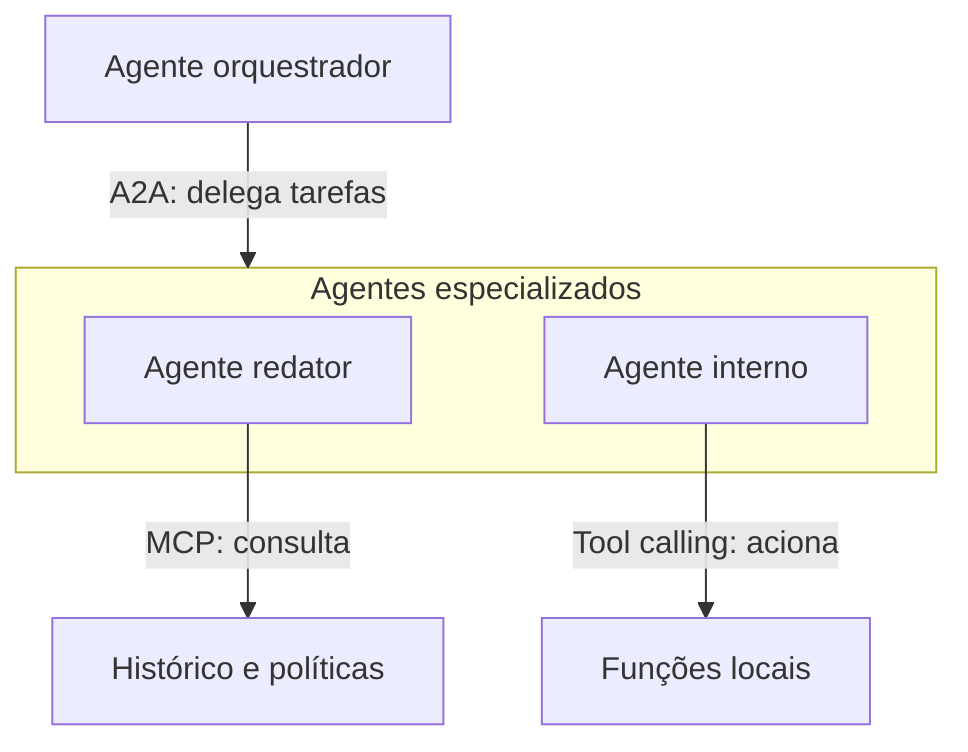

1. O orquestrador **delega** tarefas a agentes especializados por **A2A**.
2. O agente redator **consulta** o histórico e as políticas por **MCP**.
3. Um agente interno pode acionar funções locais por **tool calling**.

Cada interação usa a camada adequada. Não existe uma sigla vencedora.

**Para aprofundar:** [Fundamentos](fundamentos.md) reúne o panorama completo.

**Experimente:** o [Lab 15: assistente de pós-venda](../labs/lab-15-integrador/README.md) mostra isso funcionando. Um laboratório é um pequeno exemplo executável, e os comandos estão no README dele.

## O que os protocolos não resolvem

Protocolos organizam a conversa, mas não fazem milagre:

- **Não criam inteligência:** quem decide continua sendo o modelo, que pode errar.
- **Não padronizam o significado do negócio:** o que "pedido atrasado" quer dizer continua dependendo da sua empresa.
- **Não substituem segurança:** autenticação, autorização e conformidade continuam necessárias.
- **Não eliminam toda a complexidade:** mudam a forma como ela cresce.

A tomada padrão garante que o aparelho encaixa, mas não garante que ele funcione bem nem que a instalação elétrica seja segura.

## Tabela de analogias

| Conceito | Analogia | Onde a analogia falha |
| --- | --- | --- |
| Problema N por M | Gaveta de carregadores | O custo real inclui testes e operação, não só comprar cabos |
| Protocolo | Tomada padrão, USB | Protocolos evoluem e têm versões |
| Tool calling | Canivete no bolso | Quem escolhe a função é o modelo, mas quem a executa é a aplicação |
| MCP | Ferramenteira do prédio | O server pode executar a ação, em vez de só emprestar a ferramenta |
| A2A | Contratar um especialista | O agente contratado também é software e pode errar |
| Host | Freguês | O host também define regras e permissões |
| Client | Garçom | Também gerencia conexões e isola falhas |
| Server | Cozinha | Um host pode usar várias "cozinhas" na mesma conversa |
| Resource | Olhos | Também pode expor dados sensíveis, então exige controle |
| Tool | Mãos | Também é usada em cálculos e consultas que não alteram nada |
| Prompt | Roteiro, item de menu | Orienta, mas não garante o comportamento do modelo |
| Sampling | Segunda opinião | A resposta é provável, não uma certeza, e o recurso está *Deprecated* |
| Request sem estado | Carta completa | Tarefas longas ainda precisam de um identificador explícito para continuar |
| JSON-RPC | Comanda | Também carrega avisos sem resposta |
| `id` | Número da comanda ou senha | Só precisa ser único entre os pedidos ainda sem resposta |
| Schema | Atendente que confere o formulário | Valida o formato, não a verdade do conteúdo |
| Inspector | Scanner do mecânico | Testa o server, não o comportamento do modelo |
| Prompt injection | Bilhete escondido na carta | Filtros reduzem o risco, mas não o eliminam |
| Tool poisoning | Etiqueta de preço trocada | Também pode vir de um sistema legítimo comprometido |
| OAuth e scopes | Cartão de hotel | Envolve mais papéis e etapas que uma recepção |
| Gateway | Portaria com lista | Não substitui as demais camadas de defesa |
| Trace | Rastreio de encomenda | Mostra o caminho e as falhas, não o motivo de negócio |
| Agent Card | Cartão de visita | É lido por software e pode ser assinado para provar autenticidade |
| Task | Ordem de serviço | Uma Task encerrada nunca é reaberta |
| Artifact | Produto entregue com a nota | Pode chegar em partes, durante o streaming |

## Glossário

| Termo | Em palavras simples |
| --- | --- |
| **A2A** (Agent-to-Agent) | Protocolo para agentes de IA trabalharem juntos |
| **Agente** | IA que decide passos e usa ferramentas para cumprir um objetivo |
| **API** | Porta de entrada pela qual um programa usa outro |
| **API key** | Senha fixa que identifica quem usa uma API |
| **Bearer token** | Credencial em que basta apresentar o token para ter acesso, como um ingresso |
| **Container** | Ambiente isolado e reproduzível para rodar um programa |
| **Deprecated** | Recurso que ainda funciona, mas tem remoção prevista e não deve ser adotado em projetos novos |
| **Gateway** | Ponto de entrada que aplica regras antes de deixar um pedido passar |
| **JSON** | Formato de texto organizado em campos e valores |
| **JSON-RPC** | Regras para pedir uma operação e receber a resposta usando JSON |
| **LLM** | Modelo de linguagem, o "cérebro" que interpreta e gera texto |
| **Lock-in** | Dependência que torna caro trocar de fornecedor |
| **MCP** (Model Context Protocol) | Protocolo que liga a IA a ferramentas e dados |
| **OAuth 2.1** | Padrão para dar acesso limitado sem entregar a senha |
| **Observabilidade** | Capacidade de entender o que um sistema fez, a partir do que ele registra |
| **Protocolo** | Conjunto de regras combinadas para a comunicação entre sistemas |
| **Rate limit** | Limite de pedidos permitidos em um período |
| **Schema** | Descrição dos campos e formatos que um dado precisa ter |
| **Sem estado (stateless)** | Cada pedido traz tudo de que precisa, sem depender de pedidos anteriores |
| **Scope** | O que exatamente um token tem permissão de fazer |
| **SDK** | Kit de bibliotecas prontas para usar uma tecnologia |
| **STDIO** | Comunicação direta entre dois programas na mesma máquina |
| **Token** | Credencial digital temporária ou, em modelos de IA, pedaço de texto usado na contagem de custo |
| **Trace** | Registro do caminho de uma operação por vários sistemas |
| **Wire format** | O formato exato da mensagem que trafega entre os sistemas |

## Referências

Fontes oficiais sobre os temas deste documento.

**Versões de referência:** MCP revisão 2026-07-28; A2A 1.0.0; SDKs TypeScript `v2.4.0` e Python `v2.3.0`.

- [Especificação do MCP, revisão 2026-07-28](https://modelcontextprotocol.io/specification/2026-07-28)
- [Mudanças da revisão 2026-07-28 do MCP](https://modelcontextprotocol.io/specification/2026-07-28/changelog)
- [Recursos do MCP marcados como Deprecated](https://modelcontextprotocol.io/specification/2026-07-28/deprecated)
- [Arquitetura do MCP](https://modelcontextprotocol.io/specification/2026-07-28/architecture)
- [Versionamento e compatibilidade do MCP](https://modelcontextprotocol.io/specification/2026-07-28/basic/versioning)
- [Recursos do server no MCP](https://modelcontextprotocol.io/specification/2026-07-28/server)
- [Multi Round-Trip Requests no MCP](https://modelcontextprotocol.io/specification/2026-07-28/basic/patterns/mrtr)
- [Tools no MCP](https://modelcontextprotocol.io/specification/2026-07-28/server/tools)
- [Especificação do JSON-RPC 2.0](https://www.jsonrpc.org/specification)
- [Tratamento de erros no SDK Python v2](https://py.sdk.modelcontextprotocol.io/servers/handling-errors/)
- [Especificação do A2A, versão 1.0.0](https://a2a-protocol.org/v1.0.0/specification/)
- [Ciclo de vida de uma Task no A2A](https://a2a-protocol.org/latest/topics/life-of-a-task/)
- [OAuth 2.1 (Internet-Draft da IETF)](https://datatracker.ietf.org/doc/draft-ietf-oauth-v2-1/)
- [RFC 6750: Bearer Token Usage](https://www.rfc-editor.org/rfc/rfc6750)
- [OWASP LLM01:2025 Prompt Injection](https://genai.owasp.org/llmrisk/llm01-prompt-injection/)
- [OWASP LLM06:2025 Excessive Agency](https://genai.owasp.org/llmrisk/llm062025-excessive-agency/)
- [Docker MCP Catalog](https://docs.docker.com/ai/mcp-catalog-and-toolkit/catalog/)
- [Docker MCP Gateway](https://docs.docker.com/ai/mcp-catalog-and-toolkit/mcp-gateway/)
- [OpenTelemetry](https://opentelemetry.io/docs/)
