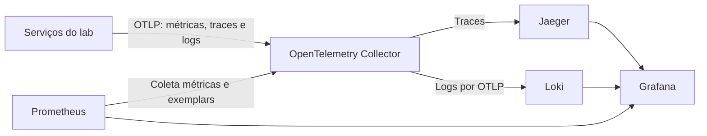
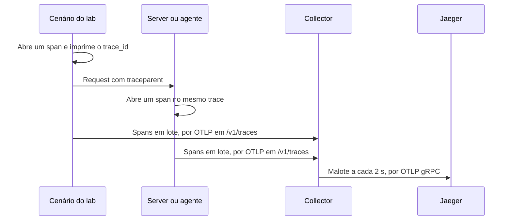
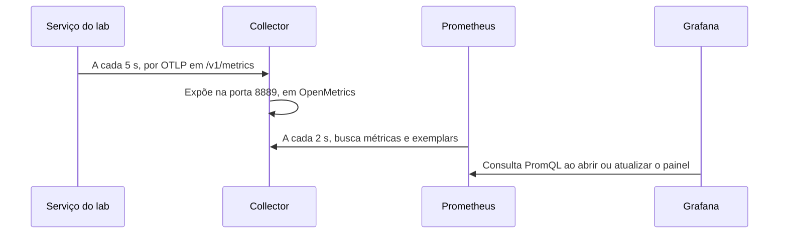
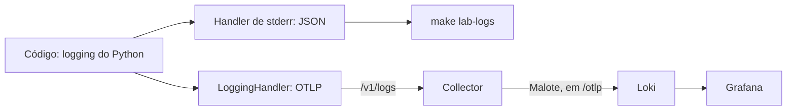
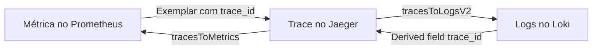
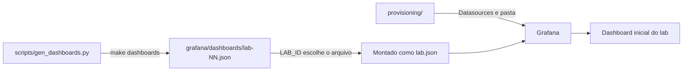
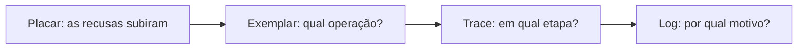

<!-- TOC -->
<!-- TOC -->

# Stack de observabilidade dos laboratórios

Esta pasta define a stack que os labs 03 a 15 incluem no próprio Compose: OpenTelemetry Collector, Prometheus, Jaeger, Loki e Grafana. Ela existe para que você veja o que um server ou agente fez, em vez de deduzir pela resposta final. Na prática, cada lab sobe com um dashboard pronto, e um mesmo `trace_id` liga métricas, traces e logs. Os labs 01 e 02 não usam a stack, porque mostram formatos de mensagem, sem execução contínua para observar.

## A ideia em um minuto

Imagine o restaurante do [Guia para leigos](../../docs/guia-para-leigos.md#3-o-restaurante-host-client-e-server) em um dia cheio. Três perguntas diferentes pedem três registros diferentes:

- **Como está o movimento?** O placar da cozinha responde: pedidos por minuto e tempo de preparo. Isso é uma **métrica**.
- **Por onde passou este pedido?** O rastreio de encomenda responde, etapa por etapa. Isso é um **trace**.
- **O que aconteceu naquele momento?** O diário de bordo responde, com uma anotação por evento. Isso é um **log**.

Os três sinais só ajudam de verdade quando estão ligados. O placar mostra que a demora subiu, o rastreio mostra qual etapa atrasou, e o diário explica o motivo. O `trace_id` funciona como o código de rastreio que permite essa navegação.

| Conceito | Analogia | Onde a analogia falha |
| --- | --- | --- |
| Métrica | Placar da cozinha | Mostra o conjunto, não um pedido específico |
| Trace | Rastreio de encomenda | Mostra o caminho e as falhas, não o motivo de negócio |
| Span | Uma etapa do rastreio | Spans podem ser aninhados e ocorrer em paralelo |
| Log | Diário de bordo | Só contém o que o código decidiu registrar |
| `trace_id` | Código de rastreio | É gerado pelo software, e um log fora de um span não o carrega |
| Exemplar | Código de rastreio colado em um ponto do placar | Aponta para uma amostra, não para todos os pedidos daquele ponto |
| Collector | Central de triagem dos correios | Encaminha os sinais, sem guardá-los como arquivo de consulta |
| `batch` | Malote | Sai a cada 2 s, mesmo sem estar cheio |
| Prometheus | Fiscal que passa e copia o placar | Copia a cada 2 s, muito mais rápido que qualquer fiscal |
| Jaeger | Balcão de consulta do rastreio | Aqui guarda tudo em memória: reiniciar apaga o histórico |
| Loki | Arquivo dos diários de bordo | Aqui descarta as anotações depois de 72 h, por padrão |
| Grafana | Sala de controle | Consulta os sinais, sem ser o local onde eles ficam guardados |
| Provisionamento | Sala de controle montada de fábrica | É configuração em arquivo, lida pelo Grafana |

## Visão geral da arquitetura

Os serviços conhecem um único endereço, o do Collector, que entrega cada sinal ao seu destino. Isso evita que cada serviço precise saber onde as métricas, os traces e os logs ficam guardados. A consequência prática é que trocar um backend altera a configuração do Collector, não o código dos labs.



Repare no sentido da seta do Prometheus: traces e logs são empurrados pelo Collector, enquanto as métricas são buscadas pelo Prometheus.

| Componente | Versão | Papel | Endereço no host | Portas internas | Retenção |
| --- | --- | --- | --- | --- | --- |
| OpenTelemetry Collector | `0.164.0` | Recebe por OTLP e encaminha | Não publicado | `4318` (OTLP HTTP), `8889` (métricas) | Não se aplica |
| Prometheus | `v3.15.1` | Guarda métricas e exemplars | <http://localhost:9090> | `9090` | 7 dias, no volume `prometheus-data` |
| Jaeger | `2.22.0` | Guarda e mostra traces | <http://localhost:16686> | `4317` (OTLP gRPC), `16686` (interface) | Em memória, até reiniciar o container |
| Loki | `3.7.9` | Guarda logs | <http://localhost:3100/ready> | `3100` | `LOKI_RETENTION_PERIOD`, 72 h por padrão, no volume `loki-data` |
| Grafana | `13.3.0` | Mostra e correlaciona os sinais | <http://localhost:3000> | `3000` | Estado próprio no volume `grafana-data` |

As portas publicadas ficam em `127.0.0.1` e podem ser alteradas no `.env`, com `GRAFANA_PORT`, `PROMETHEUS_PORT`, `JAEGER_UI_PORT` e `LOKI_PORT`.

## Como a stack entra em um lab

Cada lab inclui a mesma definição com `include`, em vez de copiar os serviços. Isso mantém versões e configuração em um só lugar. Por usarem as mesmas portas, os labs com stack rodam um por vez.

```yaml
# Trecho do compose.yaml de um lab.
include:
  - ../observability/compose.yaml
```

O `make lab-start LAB=09` define `LAB_ID=lab-09`, e esse valor tem dois usos: escolher qual dashboard o Grafana monta e identificar a telemetria dos serviços, no atributo `lab.id`. Por isso, a stack exige o `LAB_ID` e não sobe com um `docker compose up` sem ele. Use sempre o Makefile.

## Como os serviços geram telemetria

Os serviços em Python chamam `setup_telemetry("lab-09-finance")`, de [`labs_common.telemetry`](../common/src/labs_common/telemetry.py), que configura os três sinais em um único ponto. O server em TypeScript do lab 08 faz o equivalente em [`telemetry.ts`](../lab-08-sdk-typescript/server/src/telemetry.ts).

Todo sinal sai com dois atributos de recurso, `service.name` e `lab.id`. Eles são o que permite filtrar por serviço e por lab depois. O endereço de destino vem de `OTEL_EXPORTER_OTLP_ENDPOINT`, que aponta para `http://otel-collector:4318`.

Com `OTEL_SDK_DISABLED=true`, nada é enviado à stack, e restam só os logs em `stderr`.

## Fluxo de traces

Um trace é o rastreio completo de uma operação, e cada etapa dele é um span. Ele importa porque uma operação atravessa vários processos e, sem ele, cada processo conta só a sua parte. Na prática, é aqui que você descobre em qual etapa a operação falhou ou demorou.



O que mantém o mesmo código de rastreio entre os processos é o `traceparent`, definido pelo W3C Trace Context:

- **A2A:** o client propaga o `traceparent` pelo HTTP, e o agente o extrai em um middleware, como em [`a2a_http.py`](../common/src/labs_common/a2a_http.py).
- **MCP:** a revisão 2026-07-28 documenta a propagação em `_meta`, como explica [Segurança em camadas](../../docs/seguranca-camada.md#telemetria-com-opentelemetry-collector-jaeger-e-grafana). No lab 08, o server lê o valor de `params._meta` e abre os próprios spans.

`make lab-run` imprime o `trace_id` de cada passo do cenário. Basta colá-lo na interface do Jaeger para abrir o trace.

## Fluxo de métricas

Uma métrica é uma medição agregada ao longo do tempo. Ela importa porque responde com baixo custo se o sistema está saudável. Na prática, é o ponto de partida da investigação, e o exemplar é a ponte para o trace.



Quatro detalhes da configuração explicam o que você vê nos painéis:

- **Nomes mudam no caminho.** No código, a métrica é `lab.operations`; no Prometheus, vira `lab_operations_total`. Da mesma forma, `lab.operation.duration`, em segundos, gera `lab_operation_duration_seconds_bucket`.
- **Rótulos vêm dos atributos de recurso.** O `resource_constant_labels` do Collector copia `service.name` e `lab.id` para os rótulos `service_name` e `lab_id`.
- **Exemplars exigem OpenMetrics.** O exporter só os exporta nesse formato, por isso `enable_open_metrics: true`, o `scrape_protocols` do Prometheus e a flag `--enable-feature=exemplar-storage`.
- **O intervalo curto é proposital.** Um exemplar só fica exposto até a exportação seguinte do serviço, então o Prometheus coleta a cada 2 s, para não perdê-lo.

O exemplar nasce porque o histograma é gravado dentro do span, em `OperationMetrics.observe`. Assim, o ponto do gráfico carrega o código de rastreio de uma operação real, como uma etiqueta colada no placar.

## Fluxo de logs

Um log é o registro de um evento, com o detalhe que a métrica e o trace não têm. Ele importa porque costuma trazer o motivo da falha. Na prática, cada linha emitida dentro de um span leva o `trace_id`, então é possível ir do log ao trace e voltar.



O mesmo registro segue dois caminhos independentes:

- **`stderr`:** uma linha JSON, que aparece em `make lab-logs`. Em stdio, `stdout` é o canal do protocolo, e por isso os logs nunca vão para lá.
- **OTLP:** vai ao Collector e daí ao Loki. A stack não lê os logs dos containers, então uma linha que só apareça em `stderr` não chega ao Grafana.

No Loki, o atributo `service.name` vira o rótulo `service_name`, usado nas consultas, e o `trace_id` fica como structured metadata, o que exige `allow_structured_metadata: true`. A consulta abaixo é a que o Grafana usa para buscar as linhas de um trace, em todos os serviços:

```logql
{service_name=~".+"} | trace_id="<trace_id>"
```

Token e senha nunca devem ir para log nem para atributo de span, porque tudo o que entra aqui fica legível na sala de controle.

## Como os sinais se ligam no Grafana

A correlação é a navegação entre os três sinais a partir do `trace_id`. Ela importa porque evita copiar identificadores e ajustar horários à mão. Na prática, uma investigação começa em um gráfico e termina na linha de log, em poucos cliques.



Cada seta é uma configuração em [`datasources.yaml`](grafana/provisioning/datasources/datasources.yaml), que usa UIDs fixos porque os dashboards e os links dependem deles.

| De | Para | Onde clicar | Configuração |
| --- | --- | --- | --- |
| Métrica | Trace | Exemplar, a estrela em um gráfico | `exemplarTraceIdDestinations` |
| Trace | Logs | **Logs for this span** | `tracesToLogsV2`, com folga de 5 minutos em cada direção |
| Trace | Métricas | **Operações por segundo** | `tracesToMetrics`, filtrando por `service_name` |
| Log | Trace | Campo `trace_id` da linha de log | `derivedFields` |

## Como os dashboards são visualizados

Cada lab com stack tem um dashboard gerado por código, e não editado à mão. Isso mantém os treze dashboards com a mesma estrutura e permite revisá-los no Git. A consequência é que uma mudança começa no gerador, não na interface do Grafana.



O Compose monta só o JSON do lab atual e o define como dashboard inicial, na pasta **Laboratório**. O provisionamento usa `allowUiUpdates: false`, então altere o gerador e rode `make dashboards` em vez de tentar salvar pela interface.

Todo dashboard atualiza a cada 10 s, mostra os últimos 30 minutos e tem os seguintes painéis:

| Painel | Fonte | O que responde |
| --- | --- | --- |
| Texto inicial | Nenhuma | Qual é a pergunta do lab e como gerar dados |
| Painéis próprios do lab | Prometheus | A pergunta do lab, como **Bonus refusals by reason** no lab 09 |
| **Operations per second** | Prometheus | Qual é o volume, por operação e resultado |
| **Latency p95 by operation** | Prometheus | Qual operação está lenta; a linha de limite vem de `latency_threshold` |
| **Service dependencies** | Jaeger | Quais serviços chamam quais |
| **Logs** | Loki | O que o serviço escolhido na variável **Service** registrou |

Depois de subir o lab, [`grafana_seed.py`](../../scripts/grafana_seed.py) cria pela API a variável global `latency_threshold` e, nos labs 09, 12 e 15, um notebook que guia a investigação. Essas APIs estão em preview ou são experimentais, então uma falha gera só um aviso, e os dashboards continuam funcionando.

O [`grafana.ini`](grafana/grafana.ini) liga recursos em preview ou experimentais da versão 13.3, como o novo visual e os notebooks. O [README principal](../../README.md#observar-métricas-traces-e-logs) resume o que está ativo.

## Passo a passo com o lab 09

Este roteiro usa o cenário do `Finance Admin` e a trava de 20% para percorrer os três sinais.

```bash
make lab-start LAB=09   # sobe o lab e a stack, e mostra as URLs
make lab-run LAB=09     # executa o cenário e imprime os trace_id
```

1. Abra o Grafana em <http://localhost:3000>. O usuário e a senha estão no `.env`.
2. Em **Bonus refusals by reason**, veja as recusas causadas pela trava.
3. Clique em um exemplar para abrir o trace que gerou aquele ponto.
4. No trace, use **Logs for this span** para ler a linha de log da recusa.
5. Na linha de log, use o campo `trace_id` para voltar ao trace.
6. Para buscar por serviço, abra a interface do Jaeger em <http://localhost:16686> e escolha `lab-09-finance`.



## Como conferir a stack

O `make lab-smoke LAB=09` testa a correlação de ponta a ponta, em vez de só verificar se os containers estão de pé. Ao final, ele remove o lab, inclusive os volumes. O [`verify_telemetry.py`](../../scripts/verify_telemetry.py) confere, nesta ordem:

1. As métricas e os exemplars do lab chegaram ao Prometheus.
2. O trace apontado por um exemplar existe no Jaeger.
3. Os logs chegaram ao Loki e carregam `trace_id`.
4. Os datasources estão saudáveis no Grafana, e o dashboard do lab foi provisionado.
5. Toda métrica usada no dashboard tem dados.

| Sintoma | O que fazer |
| --- | --- |
| Painéis sem dados | Rode `make lab-run LAB=NN`: os dados só existem depois do cenário. Confira também o intervalo de tempo do dashboard |
| Painel **Logs** vazio | Escolha outro serviço na variável **Service** |
| Telemetria não chega | Veja os logs do Collector com `make lab-logs LAB=NN SERVICE=otel-collector` |
| Um trace antigo sumiu | O Jaeger guarda os traces em memória, e reiniciar o container apaga o histórico |
| Busca de traces no Grafana falha | Use a interface do Jaeger, como explicado em [Limitações](#limitações) |
| Porta ocupada | `make lab-start` avisa antes de subir; mude a variável da porta no `.env` |

Para comparar as imagens fixadas com as releases mais recentes, sem alterar nada, use `make check-versions`.

## Arquivos desta pasta

| Arquivo | Função |
| --- | --- |
| [`compose.yaml`](compose.yaml) | Serviços, portas, limites e volumes da stack |
| [`otel-collector/config.yaml`](otel-collector/config.yaml) | Pipelines de traces, métricas e logs |
| [`prometheus/prometheus.yml`](prometheus/prometheus.yml) | Coleta das métricas no Collector |
| [`loki/loki.yaml`](loki/loki.yaml) | Instância única do Loki, armazenamento e retenção |
| [`grafana/grafana.ini`](grafana/grafana.ini) | Feature toggles do Grafana |
| [`grafana/provisioning/`](grafana/provisioning/) | Datasources e provedor de dashboards |
| [`grafana/dashboards/`](grafana/dashboards/) | Dashboards gerados: não edite à mão |

## Limitações

Esta stack é didática e não está pronta para produção.

- **Busca de traces:** no Grafana 13.3 com o Jaeger 2.22, trace por ID e grafo de dependências funcionam, mas a busca pelo datasource responde 404, porque o Jaeger 2.21 removeu o endpoint antigo. Use a interface do Jaeger.
- **Lab 08:** o SDK TypeScript `2.4.0` não gerou spans nem métricas `mcp.*`, então o server abre os próprios spans. O OpenTelemetry para Node.js não gerou exemplars, que vêm do client em Python.
- **Persistência:** o Jaeger guarda tudo em memória, e o Loki é uma instância única, com armazenamento local e `auth_enabled: false`.
- **Tráfego interno:** o envio do Collector ao Jaeger usa `tls.insecure: true`, dentro da rede do Compose.
- **Privilégios:** todos os serviços usam `cap_drop` e limite de memória, mas o Grafana não usa `read_only`.
- **Um lab por vez:** os labs com stack usam as mesmas portas.
- **Dados:** toda a telemetria vem de cenários fictícios.

## Referências

**Versões de referência:** Grafana `13.3.0`; Prometheus `v3.15.1`; Jaeger `2.22.0`; Loki `3.7.9`; OpenTelemetry Collector `0.164.0`.

- [Sinais do OpenTelemetry](https://opentelemetry.io/docs/concepts/signals/)
- [OpenTelemetry Collector](https://opentelemetry.io/docs/collector/)
- [Prometheus exporter do Collector](https://github.com/open-telemetry/opentelemetry-collector-contrib/blob/main/exporter/prometheusexporter/README.md)
- [W3C Trace Context](https://www.w3.org/TR/trace-context/)
- [Feature flags do Prometheus](https://prometheus.io/docs/prometheus/latest/feature_flags/)
- [Jaeger: primeiros passos](https://www.jaegertracing.io/docs/latest/getting-started/)
- [Loki: envio de dados por OTLP](https://grafana.com/docs/loki/latest/send-data/otel/)
- [Exemplars no Grafana](https://grafana.com/docs/grafana/latest/fundamentals/exemplars/)
- [Provisionamento do Grafana](https://grafana.com/docs/grafana/latest/administration/provisioning/)
- [Datasource do Jaeger no Grafana](https://grafana.com/docs/grafana/latest/datasources/jaeger/)
